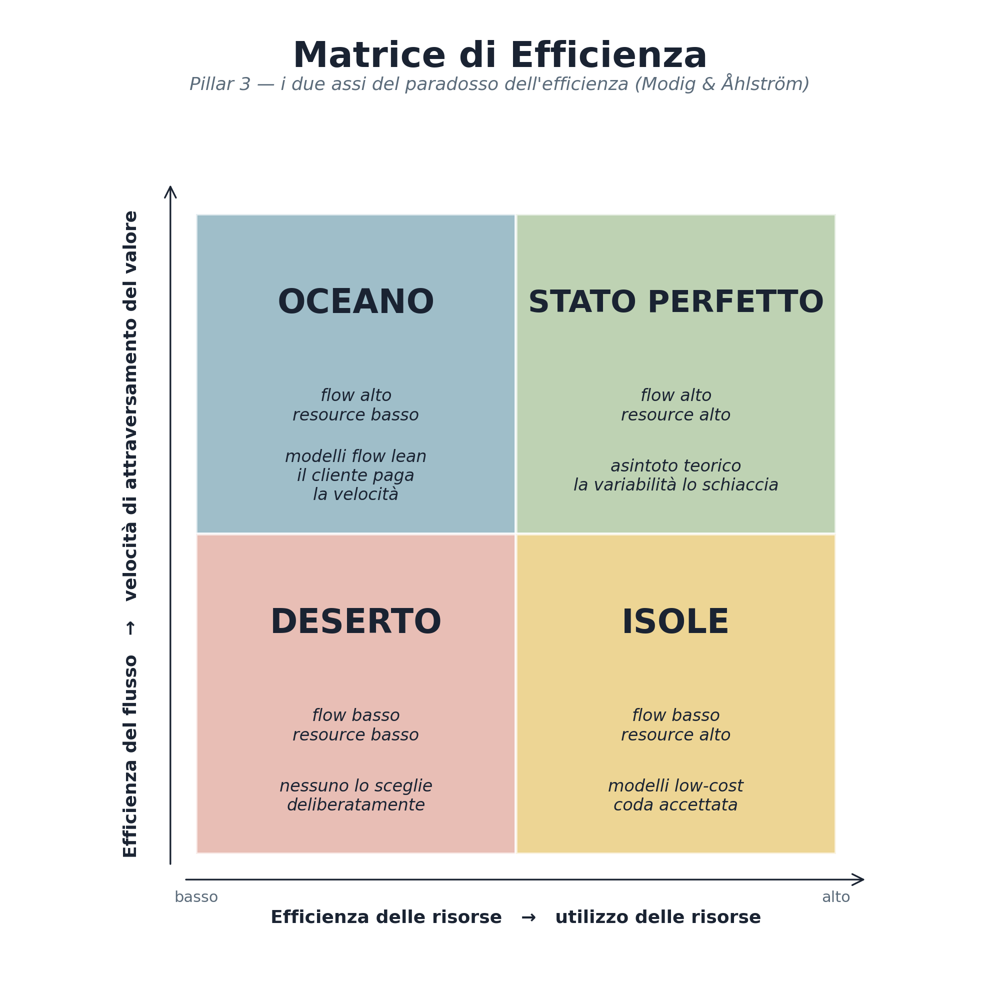
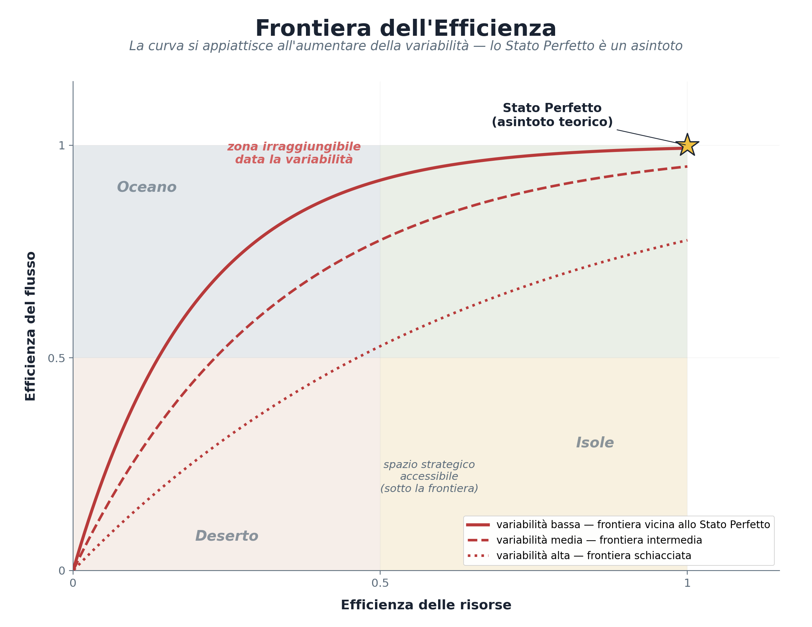

# Digital Lean Framework — Pillar e Principi Operativi

**Versione 2.4** · Maggio 2026 · Autore: [Alessio Setaro](https://www.linkedin.com/in/alessiosetaro/)

*Meno complessità, più risultati.*

> Applicazione sistematica dei principi del lean thinking ai processi umani e digitali delle organizzazioni.
> Manifesto, architettura, cinque pillar, principi operativi VALUE/STREAM/CLEAN/FLOW/KAIZEN, Digital Lean Index e applicazione per dominio.

DLF — Digital Lean Framework © 2026 Alessio Setaro · [CC BY-NC-ND 4.0](https://creativecommons.org/licenses/by-nc-nd/4.0/) · Edizione PDF nella cartella [pdf/it/](../../pdf/it/).

---

# 1. Manifesto

***Meno complessità, più risultati.***

Il Digital Lean Framework è un supporto per l'applicazione sistematica dei principi lean ai processi umani e digitali delle organizzazioni: IT and digital service delivery, cybersecurity, leadership e sviluppo delle persone, AI adoption e ai programmi di trasformazione end-to-end che attraversano questi cantieri specialistici. Ogni processo in cui complessità e spreco si annidano è un possibile terreno di applicazione.

***Perché "Digital"?***

*Digital Lean non significa lean applicato solo alla tecnologia. Significa lean per l'era digitale, un'era in cui processi umani, organizzativi e tecnologici sono inseparabili e vanno trattati come un sistema unico. Nell'era digitale, la trasformazione delle persone è la precondizione della trasformazione di business che a sua volta è precondizione per quella tecnologica. Le persone non sono un dominio separato: sono il sistema operativo su cui tutto il resto gira. *

***La Legge Zero del DLF è "il processo prima della tecnologia" e il processo è fatto di persone.***

Il DLF si applica a 4 operational tracks specialistici + 1 transversal layer di orchestrazione:

**IT and Digital Service Delivery**: I servizi IT come incident management, access management, data engineering, data platforms, BI, MLOps, observability, digital operations e i servizi digitali a supporto del business. Il flow unit è la richiesta dell'utente, il dato richiesto, la dashboard da produrre, il requisito da sviluppare. È il track più voluminoso in organizzazioni post-trasformazione, dove i sistemi sono in place ma il flusso end-to-end è ancora rotto.

**Cybersecurity:** La protezione dei processi di business da un classe di rischi: SOC, threat intelligence, vulnerability management, IAM, compliance cyber. Il flow unit è il processo da garantire integro. Lo waste qui equivale a esposizione al rischio: ogni minuto di throughput addizionale è opportunità per l'attaccante.

**Leadership & People:** Lo sviluppo delle persone come processo lean: formazione, coaching, succession, decision-making, governance, dinamiche organizzative. Il flow unit è il bisogno formativo o decisionale che diventa competenza applicata o decisione presa. Il valore si misura nel comportamento cambiato, non nella soddisfazione del corso.

**AI Adoption**: L'integrazione dell'AI nei processi esistenti, sotto il principio "process before model": prompt engineering, model deployment, AI workflow automation, agent orchestration. Il flow unit è il processo con lavoro ripetitivo da assistere. L'AI è il più potente acceleratore disponibile ma anche il più pericoloso amplificatore di complessità: il DLF stabilisce che vada applicata solo dopo aver pulito il processo.

Sopra questi 4 tracks specialistici che messi insieme rendono il DLF applicabile anche a un transversal layer:

**Digital Transformation Programs:** Iniziative end-to-end di redesign / migrazione / lancio di un processo di business, che attraversano più operational tracks contemporaneamente. Tipico esempio: lanciare una nuova piattaforma e-commerce richiede IT (nuova infrastruttura + dati), Cybersecurity (modelli di accesso e audit), Leadership & People (formazione team), AI Adoption (raccomandazioni prodotto). Al livello programma il DLF orchestra i 4 tracks sottostanti e misura l'iniziativa nel suo complesso. Il flow unit del programma è l'outcome di business del processo trasformato.

***Nota di scope:** *oggi il DLF è validato su questi 4 + 1. Le prossime versioni estenderanno ad altri operational tracks (es. Architecture **&** Platform, Product **&** UX) e ad altri transversal layers (es. Governance **&** Compliance Programs, Vendor **&** Partnership Programs) man mano che il framework viene validato in quei contesti.*

Il contesto che rende il DLF necessario:

| **Dato** | **Fonte** |
| --- | --- |
| Il 70% dei progetti di digital transformation non raggiunge gli obiettivi | BCG, 2024; Gartner, 2025 |
| Un terzo della spesa cloud globale è spreco (~$260 miliardi nel 2024) | Flexera State of the Cloud Report, 2025 |
| Solo il 15% delle PMI italiane ha una maturità cyber adeguata | Osservatorio Cybersecurity & Data Protection, Politecnico di Milano, 2026 |
| Solo il 10% dei programmi di leadership produce impatti misurabili | Voxy Global Learning & Skills Trends Report, 2025; ATD Research |

**Il denominatore comune?** Complessità non necessaria, processi non ottimizzati, tecnologia aggiunta senza aver prima pulito.

***Il Digital Lean Framework propone un ribaltamento: prima semplifica, poi digitalizza, poi automatizza. Mai il contrario.***

E per chi ha già digitalizzato? Il DLF non chiede di ricominciare da zero. Chiede di risalire il processo, mappare lo spreco generato dalla digitalizzazione stessa, e semplificare dall'interno. La remediation è parte integrante del metodo.

# Glossario rapido

*Una mappa minima per orientarsi nel resto del framework. Le definizioni complete sono in Sezione 2 (architettura), nei singoli pillar (Sezioni 5-9) e nel glossario completo alla fine del documento.*

| **Termine** | **Definizione minima** |
| --- | --- |
| **Legge Zero** | Il processo prima della tecnologia. Si applica come workflow con tre percorsi (A: non digitalizzato; B: remediation; C: processi umani). |
| **Pillar** | Uno dei cinque fondamenti concettuali del framework. I pillar dicono come è fatto e come si comporta il processo. |
| **Unità di flusso** | Chi o cosa attraversa il processo e ne riceve valore: il paziente, il ticket, la richiesta, la decisione. Mai lo strumento o l'output. |
| **Flow efficiency** | Quanto velocemente il valore attraversa il processo, dal punto di vista dell'unità di flusso. |
| **Resource efficiency** | Quanto le risorse del processo sono utilizzate. Il paradosso lean: spingerla al 100% rallenta il flow. |
| **Matrice di Efficienza** | I quattro quadranti dati dagli assi flow × resource: Deserto, Isole, Oceano, Stato Perfetto. |
| **Bisogno diretto** | Il valore "hard" che il cliente vuole davvero. |
| **Bisogno indiretto** | Il valore "soft" generato dall'attesa o dal flow basso: status, escalation, reassurance. È sintomo, non valore. |
| **Muda** | Spreco. Attività che consuma risorse senza produrre valore per il cliente. Il DLF codifica 9 muda digitali. |
| **Practitioner** | Chi applica il framework: conduce assessment, facilita sprint, applica la Legge Zero. |
| **Kaizen** | Miglioramento continuo a piccoli passi. Nel DLF è organizzato in Sprint da 2 settimane. |
| **DLI — Digital Lean Index** | Indice composito 0-100 della "salute lean" del processo. Baseline e KPI di progresso. |
| **Catena cliente-fornitore interno** | Ogni step è cliente del precedente e fornitore del successivo. L'esigenza viaggia all'indietro lungo la catena. |

# 2. Architettura del framework

## 2.1 I tre livelli di lettura

Il DLF si articola in tre livelli di lettura, in quest'ordine: valori culturali, pillar teorici, pratica operativa.

**Valori culturali (Sezione 4) :** le quattro disposizioni di base senza cui il framework non funziona:

- **lavoro in team**

- **comunicazione**

- **sobrietà di risorse ed eliminazione dello spreco**

- **miglioramento continuo**

Sono le condizioni culturali, non opzionali, su cui poggiano tutti i pillar e i principi. Senza i valori, gli strumenti diventano teatro.

**Pillar teorici (Sezioni 5-9) :** le fondamenta concettuali sono cinque:

- **Pillar 1 - Legge Zero**: il processo prima della tecnologia.

- **Pillar 2 - La catena cliente-fornitore interno**: processo diviso in una catena di sotto-fasi in cui ogni anello è cliente del precedente e fornitore del successivo. Letta a vari livelli di astrazione (processi principali e sotto-processi).

- **Pillar 3 - Le Tre Leggi del Flusso + Matrice di Efficienza**: la fisica del processo (Legge di Little, Legge dei Colli di Bottiglia, Legge dell'Effetto della Variabilità) e il quadrante strategico dato dagli assi flow × resource.

- **Pillar 4 - Bisogni diretti e indiretti e le Tre fonti di inefficienza**: la lente diagnostica del valore (cosa il flusso deve trasportare davvero, e cosa è invece "lavoro di trazione" generato da flow basso) e la lettura causale delle inefficienze (lungo throughput time, troppe unità di flusso in processo, troppi riavvii/handoff).

- **Pillar 5 - Visibilità del flusso e gestione delle anomalie (Jidoka digitale ):** Rendere visibile lo stato del flusso, identificare le deviazioni dallo standard, attivare l'intervento.

Declinato al digitale: dashboard di flow real-time, anomaly detection, digital andon, quality gate built-in.

*Una nota terminologica trasversale ai cinque pillar: l'unità di flusso è chi o cosa attraversa il processo e ne riceve valore. Il paziente in ospedale, il ticket IT, la richiesta dell'utente, la decisione da prendere. *

*Non è lo strumento o l'output, ma il soggetto del valore. Le unità di flusso possono essere materiale, informazione o persona (Modig & Åhlström), la natura dell'unità condiziona come si declinano i bisogni indiretti (massimi quando l'unità è persona). *

*Il concetto viene formalizzato operativamente nell'Assessment DLI (Sezione 11 per il concetto, Guida Operativa Sezione 2 per il workflow passo-passo).*

**Pratica operativa (Sezioni 10-12) :** il "come" applicare i pillar. i 5 Principi (VALUE con il sotto-principio Prossimità al cliente e densità di trasferimento del valore, STREAM, CLEAN, FLOW con i sotto-principi Pull e Standardizzazione, KAIZEN con la capacità evolutiva), il Digital Lean Index con il layer di posizionamento sulla matrice e l'applicazione per dominio.

**DNA del practitioner (Sezione 13) :** i 5 Superpoteri di chi applica il framework. Non sono valori e non sono pillar e non sono pratica: sono le caratteristiche personali di chi conduce il lavoro.

Senza i valori, i pillar non si reggono. Senza i pillar, la pratica si applica meccanicamente. Senza la pratica, i pillar sono filosofia. Servono tutti e in quest'ordine di lettura. Le Sezioni 14 è trasversale e usabile indipendentemente.

## 2.2 Il Digital Lean Index (DLI) come parte dell'architettura

*Il DLI è trattato operativamente in Sezione 11. Va però collocato già qui, nell'architettura, perché è il dispositivo che traduce i pillar in misura: senza una metrica composita, i pillar restano filosofia e i principi restano dichiarazioni.*

Il **Digital Lean Index** è l'indice composito che misura la "salute lean" di un processo o di un'organizzazione. Serve come baseline da cui partire e come KPI per misurare il progresso degli Sprint Kaizen sprint-su-sprint.

Sintetizza in un unico punteggio 0-100 quattro dimensioni che corrispondono direttamente ai pillar e ai principi del framework:

- **Waste Score**: quanti dei 9 muda sono presenti e con che intensità. È la misura di quanto del Pillar 4 (bisogni indiretti) e del principio CLEAN il processo sta servendo.

- **Flow Ratio**: quanto del throughput time è effettivamente lavoro vs. attesa. È la misura diretta della fisica del flusso (Pillar 3).

- **Complexity Score**: numero di tool, handoff, approvazioni, dipendenze. È la misura di quanto la catena cliente-fornitore interna (Pillar 2) è snella.

- **Value Alignment**: quanta parte del processo è collegata a un outcome misurabile per il cliente. È la misura di quanto il principio VALUE è applicato.

Il DLI non è uno strumento tra gli altri: è il **dispositivo di posizionamento** del framework. Insieme alla Matrice di Efficienza (Pillar 3), dice dove il processo sta oggi, dove può arrivare, e cosa lo tiene fermo. Per questo va dichiarato come parte dell'architettura, non come appendice metrologica.

## 2.3 Muda, practitioner, kaizen — tre termini operativi dell'architettura

*Tre termini ricorrono in ogni pagina del framework. Vanno definiti subito, qui nell'architettura, perché chi legge il DLF deve poterli usare con precisione fin dalla prima sezione. La definizione completa di ciascuno è in Sezione 10.3 (muda), Sezione 13 (practitioner), Sezione 10.5 (kaizen).*

**Muda.** È la parola lean per *spreco*: qualsiasi attività che consuma risorse senza produrre valore per il cliente. Il DLF codifica **9 muda digitali** (Sezione 10.3), ognuno mappato sul bisogno indiretto che genera. Il muda è il sintomo osservabile sul processo; le tre fonti di inefficienza (Pillar 4) ne sono la lettura causale. Aggredire il muda alla fonte spesso elimina più sintomi in un colpo.

**Practitioner.** È **chi applica il DLF**: conduce l'assessment DLI, facilita gli Sprint Kaizen, applica il workflow della Legge Zero, conduce il Lean Test.

Non è un consulente esterno calato dall'alto e non è un mero esecutore di rituali: è una persona, interna o esterna all'organizzazione, che porta i **5 superpoteri del DNA** (Sezione 13) e la disciplina dei pillar nella vita operativa del processo. Il successo del practitioner è la propria progressiva obsolescenza: quando l'organizzazione migliora da sola (capacità evolutiva, Sezione 10.5.2), il framework ha attecchito.

**Kaizen.** Parola giapponese per **miglioramento continuo a piccoli passi**. Nel DLF, il kaizen non è un'iniziativa straordinaria: è il **battito cardiaco operativo** del framework. È organizzato in **Sprint Kaizen** da 2 settimane (Sezione 10.5.1) con rituali fissi (planning, stand-up, review + retrospettiva) e una leva fisica del flusso aggredita per sprint (bottleneck, WIP, variabilità). Lo sprint senza una leva fisica esplicita è teatro lean (Sezione 3.6, Test 2).

## 2.4 Documenti operativi e skill digitale a supporto del framework

*Il framework, da solo, non è autosufficiente nell'esecuzione. Il DLF è accompagnato da una doppia infrastruttura applicativa: documenti operativi e skill digitale. Il framework definisce i principi; la guida operativa li applica.*

**Documenti operativi.**

La **Guida Operativa DLF** è il "come fare": traduce i pillar e i principi del framework in workflow passo-passo. Contiene l'assessment DLI step by step (incluso lo Step 0A-0E), la conduzione degli Sprint Kaizen, l'applicazione del workflow della Legge Zero, la checklist completa dei muda.

**Documenti satellite:** *muda-checklist*, *assessment-dli*, *sprint-kaizen*, *legge-zero-workflow* — completano il toolkit operativo.

**Skill digitale.** La **skill Lean Advisor** è l'advisor digitale del framework. Conduce assessment DLI, muda scan, sprint planning e percorsi della Legge Zero in dialogo guidato con il practitioner. È il framework reso interattivo, applicabile in tempo reale durante la conduzione di un assessment o di uno sprint.

**Separazione di ruoli: il framework definisce i principi, la guida operativa li applica.** Il DLF (questo documento) stabilisce cosa il framework *è*: valori, pillar, principi, metriche, lente diagnostica. La Guida Operativa stabilisce come si *applica*: workflow, step, template, checklist.

Questa separazione non è formale, è strutturale, e segue il principio della Sezione 3.3 (gli strumenti come contromisure temporanee): **i principi sono stabili, gli strumenti operativi evolvono**. Quando emergono pratiche migliori dal campo, si aggiorna la Guida; quando emerge una verità più profonda sul lean, si aggiorna il framework. La doppia infrastruttura permette al DLF di restare leggero nella teoria e ricco nella pratica.

# 3. Framework di applicazione del lean thinking

*Prima di descrivere come il Digital Lean Framework si applica, va dichiarato cosa il framework è. L'errore più diffuso nei framework "applicati": prendere in prestito una scuola di pensiero, semplificarla, e finire per sostituirla con il proprio set di strumenti. È esattamente l'errore che Nishida descrive nel dialogo finale di This is Lean, confondere lo strumento con il principio, e perdere per strada la cosa più importante.*

## 3.1 Il DLF è veicolo applicativo, non scuola di pensiero alternativa

**Il Digital Lean Framework non sostituisce il lean thinking. Lo applica.**

Il lean thinking, nella formulazione di Modig & Åhlström e nella tradizione Toyota da cui nasce, è una **strategia operativa**: prioritizza la flow efficiency rispetto alla resource efficiency, lavora sui processi prima che sulle risorse, dichiara come l'organizzazione produce valore. Il DLF assume questo come fondazione, non lo discute, non lo rivede. Quello che fa è renderlo applicabile in modo ripetibile sui 4 operational tracks specialistici (IT and digital service delivery, cybersecurity, leadership & people, AI adoption) e sui programmi end-to-end di trasformazione che li attraversano, dove la complessità operativa rischia di sopraffare il pensiero strategico, e dove chi vuole applicare lean spesso deve ricostruire tutto da zero.

In altre parole: il DLF sta al lean thinking come un framework operativo sta a una scuola di pensiero. Codifica un percorso che incorpora la verticale completa del lean, valori, principi, metodi, strumenti, perché il practitioner non debba reinventarla a ogni assessment.

*Se applicando il DLF stai applicando strumenti senza i valori e i principi che li giustificano, fermati! *

*Stai facendo teatro lean. Il framework senza la scuola di pensiero che lo nutre è la peggiore forma di muda: muda travestito da metodo.*

## 3.2 I quattro livelli di astrazione del lean

Pensare al lean come a un'unica cosa è la fonte di gran parte della confusione. Il lean vive su quattro livelli di astrazione distinti, e ogni livello serve quello sopra.

| **Livello** | **Cosa è** | **Cosa fa nel DLF** |
| --- | --- | --- |
| **Valori** | Come l'organizzazione *è*. Disposizioni di base. | I 4 Valori Culturali (Sez 4): lavoro in team, comunicazione, sobrietà + eliminazione spreco, miglioramento continuo. |
| **Principi** | Come l'organizzazione *pensa* e *decide*. | I 5 Pillar concettuali (Sez 5-9) — Legge Zero, Catena interna, Tre Leggi del flusso + Matrice, Bisogni diretti/indiretti, Visibilità del flusso. Direzioni di pensiero, non procedure. |
| **Metodi** | Cosa l'organizzazione *fa* per applicare i principi. | I 5 Principi Operativi VALUE → STREAM → CLEAN → FLOW → KAIZEN (Sez 10). L'Assessment DLI, gli Sprint Kaizen, il workflow Legge Zero. |
| **Strumenti** | Cosa l'organizzazione *ha* a disposizione. | VSM, muda checklist, DLI dashboard, kanban board, matrice impatto/complessità, formule di calcolo, template. *Contromisure temporanee* ai problemi del contesto attuale. |

**Il DLF abbraccia tutti e quattro i livelli, non solo uno.** Questa è la differenza tra un framework di applicazione e una scatola di strumenti. Una scatola di strumenti vive al livello 4 e basta e produce teatro. Un framework di applicazione vive sui quattro livelli in coerenza verticale i valori orientano i principi, i principi guidano i metodi, i metodi scelgono gli strumenti, e il tutto serve il valore del cliente che sta sopra ogni livello.

## 3.3 Gli strumenti come contromisure temporanee

Un punto sottile ma importante: gli strumenti lean (kanban, andon, 5S, A3, anche il DLI e i template del DLF) sono **contromisure temporanee** ai problemi che il contesto attuale presenta. Non sono il framework. Sono le soluzioni che oggi funzionano meglio per i problemi specifici dell'organizzazione che li applica; domani, in un contesto diverso, gli strumenti possono cambiare. Toyota, punto di riferimento della filosofia lean, ha mantenuto i valori e i principi per decenni; gli strumenti li ha aggiornati continuamente.

**Implicazione operativa:** quando uno strumento del DLF non sta producendo valore, è candidato alla revisione o all'eliminazione. La verifica è semplice: lo strumento serve ancora i principi e i valori? Se sì, mantienilo. Se no, sostituiscilo.

Non c'è devozione a nessuno strumento del framework, c'è solo devozione al valore che il framework deve servire.

## 3.4 La confusione dei livelli — l'errore più diffuso

L'errore più frequente non è applicare male il lean. È applicarlo al livello sbagliato di astrazione. Tre antipattern classici:

- **Lo strumento confuso con il metodo:** "Facciamo lean perché usiamo le kanban board." La kanban board è uno strumento; senza un metodo che la inquadri (cap su WIP, pull system, focus sul bottleneck), produce solo una to-do list più colorata.

- **Il metodo confuso con la strategia:** "Implementiamo il DLF." Implementare il framework è un mezzo; la strategia è spostare l'organizzazione verso la flow efficiency. Se l'implementazione del framework non avvicina alla strategia, si sta facendo teatro lean.

- **La strategia confusa con il valore:** "Vogliamo essere flow-efficient." La flow efficiency è strategia; il valore è cosa serve davvero al cliente. Se la flow efficiency non sta servendo l'esigenza del cliente, si è scelta la strategia sbagliata.

*Il DLF è un mezzo, non un fine. Se applicarlo non sta avvicinando l'organizzazione al valore del cliente, fermati e ricontrolla la catena valore → strategia → metodo → strumento. Qualcosa si è rotto a un livello superiore.*

## 3.5 Cosa questo implica per chi usa il DLF

Chi applica il DLF tiene a mente sei corollari operativi:

- Non chiedere "come si fa il Value Stream Mapping (VSM)?". Chiedi "cosa stiamo cercando di vedere?". Lo strumento serve la domanda, non viceversa.

- Non misurare il successo del DLF sul numero di assessment fatti o sugli sprint completati. Misuralo sul progresso del processo verso il quadrante target della matrice di efficienza.

- Quando uno strumento del framework non sta producendo valore, è candidato all'eliminazione. Anche gli strumenti lean possono diventare muda se applicati meccanicamente. *Sono contromisure, non dogmi.*

- La Legge Zero (Sezione 5) dice "processo prima della tecnologia". Questa sezione dice qualcosa di simile ma a un livello superiore: valore prima della strategia, strategia prima del metodo, metodo prima dello strumento. Mai il contrario.

- Se l'organizzazione "fa lean" da anni senza risultati, quasi sempre la diagnosi è: strumenti applicati senza la strategia che li giustifica. Non serve più formazione sugli strumenti — serve allineare l'organizzazione sulla strategia.

- Il DLF non è alternativa al lean thinking. È un suo veicolo applicativo. Se il framework e il lean thinking entrano in conflitto, vince il lean thinking.

## 3.6 Il Lean Test — Tre domande anti-teatro lean

*La Sezione 3 dichiara cos'è il DLF e contro cosa si oppone (il teatro lean). Ma una dichiarazione non basta, serve un test operativo che il practitioner possa fare regolarmente per riconoscere il teatro lean in flagranza, mentre sta accadendo, non a posteriori.*

*Sono tre domande, una per ciascun livello della gerarchia lean (strumento, metodo, strategia). Si pongono periodicamente, di norma a fine sprint, durante la retrospettiva, prima che la prossima riunione cancelli l'onestà che la retrospettiva richiede.*

Il Lean Test non è una checklist di compliance. È un check di onestà intellettuale. Le risposte non si scrivono nel report; si pensano. Se anche una sola delle tre risposte è "no" o "non lo so", il framework sta scivolando verso il teatro lean e va corretto subito, prima che la deriva diventi cultura.

### Test 1 — Lo strumento orfano (livello strumento → metodo)

| *Per ogni strumento del DLF che ho applicato questa settimana VSM, DLI, kanban, sprint planning, retrospettiva, dashboard, soglie, matrice, riesco a nominare in 30 secondi: (a) il principio del framework che lo strumento serve (b) il valore concreto che il cliente del processo riceve grazie a quel principio?* |
| --- |

Se non riesci, lo strumento è **orfano**: è una procedura che fai perché si fa, scollegata dai principi e dai valori. È la forma più diffusa di teatro lean, gli strumenti restano, il significato evapora.

**Esempio di strumento orfano**: "Facciamo lo stand-up del lunedì perché lo sprint lo prevede." (Strumento senza principio.)

**Esempio di strumento collegato**: "Facciamo lo stand-up del lunedì per verificare le deviazioni del flow rispetto al dashboard di flow (Pillar 5), in modo da poter intervenire prima che la deviazione diventi un problema strutturale che genera bisogni indiretti per il cliente."

Se il test 1 fallisce: ferma l'uso dello strumento orfano fino a quando non ne riconosci il principio. ***Meglio non farlo che farlo a vuoto.***

### Test 2 — Il metodo cosmetico (livello metodo → strategia)

| *Negli ultimi 3 sprint, una delle metriche di flusso del processo si è mossa? Il DLI è salito? Il flow ratio è migliorato? La posizione sulla matrice di efficienza si è spostata? Il throughput time è sceso? Il lavoro di trazione (status update, escalation, sollecito) è diminuito?* |
| --- |

Se hai fatto 3 sprint con i rituali completi (planning, stand-up, review, retro) ma nessuna delle metriche di flusso si è mossa, stai facendo **metodo cosmetico**: i rituali ci sono, ma il processo non sta migliorando. È la seconda forma più diffusa di teatro lean, la macchina del framework gira a vuoto.

**Esempio di metodo cosmetico**: "Abbiamo completato gli sprint, le retrospettive sono state ricche, gli interventi sono stati eseguiti, ma il DLI è fermo a 45 da 6 settimane e il flow ratio non è cambiato." (Metodo senza effetto.)

**Esempio di metodo che produce strategia**: "Dopo 3 sprint, il DLI è passato da 32 a 48, il throughput time si è ridotto del 30%, il quadrante è passato da Deserto a parte bassa di Isole." (Metodo che muove la strategia operativa.)

Se il test 2 fallisce: ferma gli sprint e fai una **diagnosi dura**. Probabilmente uno dei tre: (a) stai aggredendo i sintomi e non la fonte di inefficienza dominante (Pillar 4); (b) gli interventi sono troppo piccoli per spostare l'ago; (c) il management ha cambiato priorità ma nessuno l'ha detto e il framework sta operando in un vuoto di mandato.

### Test 3 — La strategia in fuga (livello strategia → valore)

| *Negli ultimi 3 sprint, qualche cliente del processo, interno o finale, ha avuto un'esperienza tangibilmente migliore? Lead time più corto percepito da chi aspetta, meno solleciti che il cliente deve fare, meno escalation che il cliente deve scrivere, meno "a che punto è" che il cliente deve chiedere?* |
| --- |

Se i miglioramenti sono solo nelle metriche interne e *nessun cliente se ne accorge fuori*, la strategia è **in fuga dal valore**: stai ottimizzando il processo ma il valore non sta arrivando dove deve arrivare. È la forma più sottile e più pericolosa di teatro lean, perché passa anche il test 2 (le metriche si muovono!) ma fallisce dove conta davvero (il cliente non riceve di più).

**Esempio di strategia in fuga**: "Il throughput time è passato da 48h a 24h, ma i nostri clienti non se ne sono accorti perché ricevono comunque la risposta alla fine della giornata lavorativa, e il loro pain point reale era la *prevedibilità*, non la velocità."

**Esempio di strategia ancorata al valore**: "Il throughput time è passato da 48h a 24h, e i clienti hanno smesso di chiamarci per chiedere lo stato, il 25% del tempo del team dedicato al lavoro si è liberato. Il cliente lo nota, il team lo nota, le metriche lo confermano."

Se il test 3 fallisce probabilmente hai sbagliato a definire cosa il cliente vuole davvero, e stai ottimizzando una variabile sbagliata.

### Come e quando si applica il Lean Test

Cadenza consigliata:

- **Mai meno di 1 volta a sprint** (fine sprint, dentro la retrospettiva, come 6ª domanda)

- **Sempre prima di una promozione di framework** (da dev a production, da versione a versione)

- **Sempre dopo una richiesta di "scaling "** ("estendiamo il DLF al team X"), perché lo scaling moltiplica il teatro lean se il teatro è già presente nel piccolo

Chi conduce il test: idealmente il practitioner *con* l'Owner del processo, *senza* chi ha un interesse a mantenere lo status quo. Le risposte oneste richiedono un setting onesto. Se il test si fa in plenaria con il management, le risposte saranno cosmetiche e il test diventa esso stesso teatro lean.

*Tre risposte sì = il framework sta funzionando come pensato. Una risposta no = correggi subito. Due risposte no = ferma e rifletti prima del prossimo sprint. Tre risposte no = il framework è in teatro lean, torna alla Legge Zero e ricomincia.*

# 4. I 4 Valori Culturali del Digital Lean

*I valori sono ciò che il framework richiede all'organizzazione, prima ancora che agli strumenti. Senza questi quattro, il framework si applica ma non produce risultati duraturi. Sono il "Toyota Way" rivisitato per il contesto digitale.*

La distinzione tra valori e principi operativi è importante e va dichiarata.

I 5 principi operativi (VALUE, STREAM, CLEAN, FLOW, KAIZEN) dicono come si applica il framework. I 4 valori culturali dicono come si sta nel framework, quali disposizioni l'organizzazione deve incarnare perché i principi producano risultati. Senza i valori, i principi diventano procedure, con i valori, diventano cultura.

## 4.1 Lavoro in team

Nessun assessment, nessun sprint, nessun miglioramento è atto individuale. Il DLF è strutturalmente collettivo: l'unità di flusso attraversa più persone, più team, più funzioni, quindi il pensiero che la migliora deve essere collettivo. Il practitioner non sostituisce il team: lo facilita.

Nel digitale enterprise il rischio è alto: i tool individuali abilitano lavoro isolato, le metriche di produttività individuale incentivano l'ottimizzazione locale, le architetture a microservizi spingono verso team verticali che ottimizzano il proprio output anziché il valore lungo la catena. Il valore "lavoro in team" combatte questa deriva: il DLF chiede esplicitamente che l'assessment si conduca in gruppo (Owner + operatori + stakeholder), che lo sprint sia collettivo, che la retrospettiva sia condivisa.

## 4.2 Comunicazione

La comunicazione strutturata è la linfa del lean. Senza, il flusso si interrompe, le decisioni non viaggiano, le anomalie non emergono, l'apprendimento non si accumula. Ma "comunicazione" non è una categoria unica: il DLF distingue quattro tipi, perché 2 sono valore e 2 muda.

**T assonomia della comunicazione lean:**

| **Tipo** | **Cos'è** | **Esempi** | **Categoria** |
| --- | --- | --- | --- |
| **Rituale** | Comunicazione cadenzata, prevedibile, scopo dichiarato. | Sprint planning, stand-up Monday, sprint review, retrospettiva. | **Valore** |
| **Strutturata** | Comunicazione formalizzata e tracciata, spesso asincrona. | Decision Record (Legge Zero), Value Stream Map, Report DLI, Sprint Card. | **Valore** |
| **Di servizio** | Risposta a un bisogno reale del cliente che il processo non ha ancora soddisfatto. | Aiuto operativo, escalation legittima, gestione di una vera eccezione. | **Muda** |
| **Di trazione** | Comunicazione generata da flow basso. Sintomo, non valore. | "A che punto è X?", status update, dashboard di stato ticket, riunioni di review backlog, escalation di sollecito. | **Muda** |

Distinguere è cruciale. Investire in comunicazione di trazione (più riunioni di stato, dashboard più dettagliate, escalation più rapide, customer support più ampio per gestire i solleciti) significa investire in muda, anche se sembra "servizio al cliente". La leva è ridurre il flow time, non la comunicazione che lo nasconde.

La comunicazione di servizio merita una nota: è valore solo se non sostituisce il fix del processo. Un service desk che risponde rapidamente ai solleciti su ticket aperti da settimane sta facendo comunicazione di trazione, non di servizio. Il test è la domanda: "se il processo chiudesse in metà del tempo, questa comunicazione esisterebbe ancora?". **Se no, è di trazione.**

## 4.3 Sobrietà di risorse ed eliminazione dello spreco

Questo è il valore più importante da riformulare correttamente. Nel Toyota Way classico si parla di "uso efficiente delle risorse"; questa formulazione, presa alla lettera crea il paradosso dell'efficienza: spingere ogni risorsa al 100% di utilizzo collassa il flow e amplifica la variabilità.

Per il DLF il valore va riformulato in modo non ambiguo:

***Sobrietà di risorse + eliminazione dello spreco.***

**Sobrietà di risorse** significa: non disperdere energia, attenzione, capitale, persone su iniziative parallele, tool ridondanti, processi non al valore. Significa anche tenere buffer di capacità per assorbire variabilità, la sobrietà non è saturazione massima.

**Eliminazione dello spreco** significa: aggredire i 9 muda (Sezione 10.3) sistematicamente, con la lente dei bisogni indiretti come amplificatore (Sezione 8).

La distinzione è netta: la saturazione delle risorse al 100% non è efficienza, è dispersione di flow. Un team al 100% di utilizzo non ha capacità di assorbire un picco, e quindi genera coda. La coda è muda. Quindi spingere l'utilizzo a 100% genera muda. È un valore controintuitivo che il framework dichiara apertamente perché è il punto su cui il lean occidentale spesso fallisce.

## 4.4 Miglioramento continuo

Il miglioramento non è un progetto. È un'abitudine, una cadenza, una disposizione mentale che non si esaurisce con il primo Sprint Kaizen né con il primo Report DLI. Il DLF struttura il miglioramento continuo con sprint da 2 settimane, retrospettive, ri-assessment del DLI sprint su sprint (Step 6 dell'assessment). Ma l'abitudine viene prima della cadenza: senza la disposizione, la cadenza è teatro.

Concretamente, questo valore richiede: che la retrospettiva produca cambiamenti, non solo elenchi; che il Report DLI venga riaggiornato e confrontato con la baseline; che il movimento sulla matrice di efficienza venga tracciato sprint su sprint; che i superpoteri del practitioner (Sezione 13) includano il coraggio di sottrarre, togliere ciò che non funziona, anche se è stato faticoso costruirlo.

## 4.5 Come la metodologia attua i 4 valori

Il framework può dichiarare valori, ma se la metodologia non li attua, restano slogan. Questa tabella mappa esplicitamente ogni valore alle parti del framework che lo realizzano, è il test di coerenza interna del DLF.

| **Valore** | **Come la metodologia lo attua** | **Dove vive nel framework** |
| --- | --- | --- |
| **Lavoro in team** | Rituali Sprint Kaizen (planning, stand-up, review, retro) collettivi per costruzione. Assessment DLI condotto in gruppo (Owner + 2-3 operatori + 1 stakeholder, mai dal solo practitioner). VSM costruito in sessione condivisa. La catena cliente-fornitore interno (Pillar 2) richiede che ogni step dichiari al team adiacente cosa sta consegnando, comunicazione collettiva, non individuale. | Sez 6 (Pillar 2), Sez 10.5 (KAIZEN), Guida Operativa Sez 4 (Sprint), Sez 2 (Assessment con CON CHI definito) |
| **Comunicazione** | Stand-up Monday come comunicazione settimanale strutturata. Decision Record (Legge Zero) come comunicazione delle scelte. VSM come comunicazione visiva del processo. La distinzione bisogni diretti/indiretti dichiara apertamente quale comunicazione è valore e quale è muda. La mini-tassonomia (4.2) inquadra i quattro tipi. | Sez 4.2 (tassonomia), Sez 8 (Pillar 4 bisogni), Sez 6 (Pillar 2 catena), Sez 10.5 (KAIZEN) |
| **Sobrietà + eliminazione spreco** | Principio CLEAN ed eliminazione dei 9 muda. Legge Zero che impedisce di accumulare tool. Matrice impatto/complessità che prioritizza investimenti. Cap su WIP (Pillar 3- Legge di Little) che impedisce di disperdere energia su iniziative parallele. La matrice di efficienza che spiega perché spingere ogni risorsa al 100% è dispersione, non efficienza. | Sez 7 (Pillar 3 + Matrice), Sez 10.3 (CLEAN), Sez 5 (Legge Zero) |
| **Miglioramento continuo** | Principio KAIZEN. Sprint da 2 settimane con review + retrospettiva. Step 6 dell'assessment (ri-assessment). DLI pre/post per tracciare il progresso. Le metriche di fisica del flusso monitorate sprint su sprint. Tracking del movimento sulla matrice di efficienza. | Sez 10.5 (KAIZEN), Sez 11 (DLI + Matrice), Guida Operativa Sez 4 |

*Se applicando il DLF non vedi questi quattro valori emergere nella tua organizzazione, fermati: stai applicando gli strumenti senza il sistema. Il framework senza i valori è teatro lean, la peggiore forma di muda.*

# 5. Pillar 1 — Legge Zero

 **Il Processo prima della Tecnologia**

***Non partire mai dalla tecnologia per plasmare il processo. Parti dal processo per scegliere la tecnologia.***

Questa è la legge fondamentale del Digital Lean Framework. Viene prima di tutto il resto perché, se violata, rende inutile qualsiasi altro principio. È il peccato originale della trasformazione digitale: comprare il tool e poi adattarci il processo. Scegliere la piattaforma e poi costringere le persone a lavorare come il software ha deciso.

Il peccato originale ha due facce: partire dalla tecnologia per plasmare il processo, e trasformare digitalmente un processo senza prima ripensarlo. Sistemi nuovi, logiche vecchie. Interfacce moderne che nascondono flussi obsoleti. La stessa complessità di prima, solo con un vestito più elegante.

## 5.1 Legge Zero come workflow operativo

La Legge Zero si applica come un workflow decisionale con tre percorsi:

**Percorso A - Processo non ancora digitalizzato**

- **COMPRENDI** il problema reale e il processo esistente. Parla con chi lo vive ogni giorno.

- **OTTIMIZZA** il processo a prescindere dalla tecnologia. Elimina gli sprechi, semplifica i passaggi, riduci i handoff.

- **SCEGLI** la tecnologia che serve il processo ottimizzato. Non il contrario.

- **ADATTA** la tecnologia al processo, mai il processo alla tecnologia.

**Percorso B - Processo già digitalizzato (Remediation)**

- **MAPPA** lo stato attuale del processo digitalizzato. Come funziona davvero, non come dovrebbe funzionare sulla carta.

- **IDENTIFICA** il waste generato dalla digitalizzazione stessa: workaround, duplicazioni, complessità aggiunta, funzionalità mai usate, processi adattati al software.

- **SEMPLIFICA** il processo DENTRO il sistema esistente. Non buttare via tutto, riporta ordine in ciò che hai costruito.

- **DECIDI** cosa tenere, cosa eliminare, cosa riprogettare. Basandoti su dati, non su opinioni.

**Percorso C - Processi umani e organizzativi (Leadership, People, Cultura)**

La Legge Zero si applica anche ai processi non digitali. La "tecnologia" da non anteporre al processo può essere un framework organizzativo, una metodologia di formazione, un modello di leadership, un tool di assessment.

- **COMPRENDI** il bisogno organizzativo reale. Non partire dalla piattaforma di e-learning, dal modello di competenze preconfezionato, o dall'assessment standardizzato.

- **OSSERVA** come funziona il processo umano oggi: come si prendono le decisioni, come si sviluppano le competenze, come circola l'informazione tra le persone.

- **PROGETTA** l'intervento a partire dal processo umano, non dallo strumento. La formazione serve al processo, non il contrario.

- **SCEGLI** lo strumento (se serve) solo dopo aver definito il processo. A volte lo strumento migliore è una conversazione strutturata, non una piattaforma.

# 6. Pillar 2 — La Catena Cliente-Fornitore Interno

*La Legge Zero dice DA DOVE partire (dal processo, non dalla tecnologia). La catena cliente-fornitore interno dice COME è fatto il processo e perché ogni sotto-fase non è un'isola ma un anello di valore.*

## 6.1 Il concetto

Ogni processo è una catena di sotto-fasi. La sotto-fase B è cliente della sotto-fase A (riceve da A un output da lavorare) e fornitore della sotto-fase C (consegna a C un output da lavorare). All'estremo della catena c'è il cliente finale, che porta l'esigenza, l'unità di flusso. Quell'esigenza si propaga all'indietro lungo la catena: ogni step interno serve l'esigenza del proprio cliente interno, e tutti insieme servono l'esigenza del cliente finale.

Il principio è antico nel lean è il "next operation as customer" del Toyota Production System, ma è raramente codificato nel digitale, dove ogni team tende a misurarsi sui propri output (sprint velocity, tickets closed, lines of code, projects delivered) anziché sul valore consegnato al team a valle. Il risultato sono ottimizzazioni locali che peggiorano il flusso complessivo, perché ogni team ottimizza la propria produzione senza chiedersi cosa la fase successiva riceve.

## 6.2 Perché è un pillar, non uno strumento

Il Value Stream Mapping (Principio STREAM, Sezione 10.2) è uno strumento: descrive cosa succede nel processo. La catena cliente-fornitore interno è un pillar: dichiara come va letto il processo, prima ancora di mapparlo. Senza questo pillar, il VSM è descrizione (dove va il tempo); con questo pillar, il VSM diventa norma (ogni step si misura sul valore consegnato al proprio cliente interno, non sull'utilizzo della propria risorsa).

È anche il collante strutturale tra Legge Zero e Tre Legg del flussoi: la Legge Zero dice "parti dal processo", la catena dice "come è fatto il processo che stai analizzando", le Tre Leggi spiegano come quel processo si comporta fisicamente. Senza la catena, manca il pezzo strutturale tra il "da dove" e il "come si comporta".

## 6.3 Il test diagnostico: tre domande per ogni sotto-fase

Per ogni sotto-fase del processo, il practitioner deve poter rispondere a tre domande. Se non sa rispondere, la sotto-fase non è ancora compresa:

- **Chi è il mio cliente interno?** Lo step immediatamente a valle. Nome, ruolo, team, cosa riceve da me. Risposta vaga ("poi va in operations") = pillar non applicato.

- **Cosa gli sto consegnando?** L'output concreto: non un'astrazione, ma il dato/documento/decisione/sistema effettivo. E quel "cosa" serve davvero il bisogno del cliente finale, o è una convenzione interna sopravvissuta alla sua utilità? Il test: se elimino questo output, il cliente finale se ne accorge?

- **Quale bisogno indiretto sto generando nel mio cliente interno?** Se il cliente interno mi chiama per status, se fa escalation, se duplica il mio lavoro per controllare, se chiede modifiche tardive è muda di trazione interno alla catena (vedi Pillar 4 e Sezione 4.2).

## 6.4 La catena amplifica la lente bisogni diretti/indiretti

Il Pillar 4 (Sezione 8) introduce la lente Modig & Åhlström: i bisogni indiretti sono sintomo di flow basso e generano lavoro di trazione. Quando questa lente si applica alla catena interna, il quadro si arricchisce: ogni step può generare bisogni indiretti nel proprio cliente interno, non solo nel cliente finale.

Un esempio concreto. Un team di sviluppo che consegna codice scadente al team QA crea nel QA bisogni indiretti: richieste di chiarimento ("cosa volevi fare qui?"), riconsegne ("questo non funziona, sistemalo"), "a che punto sei con la correzione?". Il QA, intasato da questi bisogni indiretti, consegna a sua volta scadente al team operations, perché il tempo che il QA avrebbe dovuto dedicare a testare seriamente è stato consumato da chiarimenti. Operations a sua volta genera bisogni indiretti verso il cliente finale ("il deploy è in ritardo, vi terremo aggiornati"). E così via.

***Il muda di trazione non è solo all'estremo della catena: si annida in ogni anello. La catena cliente-fornitore interno è il microscopio della lente Modig & Åhlström.***

Operativamente, questo significa che il muda generato lungo la catena è spesso più grande di quello visibile al cliente finale. Il cliente finale vede solo l'ultima delle riconsegne e dei ritardi; ogni anello a monte ne ha visto qualcuno suo. Aggredire la catena interna è quindi spesso più efficace che aggredire l'interfaccia col cliente finale — perché si risolve a monte ciò che a valle si limita a manifestarsi.

## 6.5 Livelli di astrazione del processo

Un processo può essere descritto a vari livelli di astrazione. Un'organizzazione può essere vista come un insieme di pochi processi principali, ognuno dei quali contiene vari sotto-processi, che a loro volta contengono attività. Dire "quanti processi ha l'azienda" non ha una risposta univoca: dipende dal livello di astrazione che si è scelto. Lo stesso vale per i confini del sistema (vedi Step 0A esteso nella Guida Operativa): cambiando i confini, cambia il throughput time misurato e cambia il livello dei bisogni indiretti rilevati.

Implicazione operativa per la catena interna: la stessa catena cliente-fornitore può essere letta a livelli diversi.

- **Livello macro:** il processo "incident response" come catena di team (Help Desk → L2 → Engineering → Communication).

- **Livello me dio:** dentro il team L2, la catena di ruoli (analista junior → senior → team lead).

- **Livello micro:** dentro l'attività dell'analista L2, la catena di passi (triage → analisi log → ipotesi → test → escalation).

Ogni livello produce una catena cliente-fornitore valida. La scelta del livello dipende dal problema che si vuole vedere. Per un assessment DLI iniziale, di norma si parte dal livello macro; se emerge un bottleneck specifico, si zooma sul livello medio o micro proprio dentro quel bottleneck.

*Cambiare livello di astrazione non è zoomare meccanicamente: è scegliere una nuova lente che fa vedere cose diverse. La scelta del livello è parte della definizione dei confini del sistema, e va dichiarata esplicitamente nell'assessment (vedi Step 0A esteso).*

## 6.6 Come si opera nel processo

L'operazionalizzazione concreta è nell'Assessment DLI, nello Step 0D (Guida Operativa Sezione 2.1.4): dopo aver identificato l'unità di flusso (0A), l'orientamento sulla matrice di efficienza (0B), e i bisogni diretti/indiretti del cliente finale (0C), si scompone il processo nelle sotto-fasi e per ognuna si compila una matrice (cliente interno / output consegnato / bisogno indiretto generato). Questa matrice diventa prerequisito del VSM (Step 2).

Template della matrice catena interna:

| **Sotto-fase** | **Cliente interno (chi sta a valle)** | **Output consegnato** | **Bisogno indiretto generato** |
| --- | --- | --- | --- |
| Es: Triage Incident | Analista L2 | Ticket con classificazione severity + log iniziali | Richieste di re-classificazione se severity è imprecisa |
| Es: Code Review | Team QA | Codice mergiato con checklist review | Riconsegne se review è formale ma non sostanziale |
| [...] | [...] | [...] | [...] |

# 7. Pillar 3 — Le Tre Leggi del Flusso + La Matrice di Efficienza

*La Legge Zero ti dice DA DOVE partire. La catena cliente-fornitore (Pillar 2) ti dice COME è fatto il processo. Le Tre Leggi del Flusso ti dicono COSA governa il processo una volta che ci sei dentro, qualunque tecnologia ci metti sopra. La Matrice di Efficienza ti mostra DOVE il processo si posiziona strategicamente come risultato di queste leggi.*

Sono leggi nate nel manufacturing e nella teoria delle code, studiate da decenni. Nei processi digitali e umani agiscono identicamente, solo, non sono ancora codificate per quel contesto. Sono le tre leggi che spiegano il paradosso dell'efficienza descritto da Niklas Modig e Pär Åhlström in This is Lean: spingere ogni risorsa al 100% di utilizzo non rende il processo più veloce, lo rende più lento. È contro-intuitivo, ma è fisica.

Capirle è la differenza tra "fare lean" e "fare lean che funziona".

## 7.1 La Legge di Little: WIP e tempo di attraversamento

**Throughput Time = Work In Progress × Cycle Time**

In parole: il tempo che un'unità di flusso impiega ad attraversare un processo dipende dal numero di unità che sono in lavorazione contemporaneamente (WIP) e dal tempo medio di lavorazione di ciascuna (Cycle Time).

**Analogia: la tangenziale.** Se ci sono 10 auto, ognuna scorre veloce. Se ce ne sono 200, ognuna avanza piano. La capacità della strada non cambia, ma il tempo che impiega la singola auto a passare cresce con quante ne hai in mezzo.

**Implicazione operativa.** Se vuoi accorciare il tempo di attraversamento di un processo, hai due leve:

- **ridurre il tempo medio di lavorazione (difficile, richiede ingegneria del processo)**

- **ridurre il WIP (più rapido, richiede disciplina).** 

Nel manufacturing pull, nelle metodologie Kanban, nelle pratiche di sviluppo software con WIP limit, è sempre la seconda leva quella che produce risultati per prima.

**Dove si vede nel digitale.** Backlog gonfi. Sviluppatori con 7 task in parallelo. Team che gestiscono 30 incident aperti contemporaneamente. Programmi con 12 progetti "in corso" e 0 finiti. Tutti casi di WIP fuori controllo che gonfia il throughput time di tutto il portafoglio.

**Come si misura.** Per ogni step del value stream: contare le unità in attesa o in lavorazione in un momento dato (WIP), misurare il tempo medio di lavorazione di una singola unità (Cycle Time), moltiplicare. Il risultato è il Throughput Time atteso teorico. Il Throughput Time reale misurato spesso è più alto: la differenza è data da variabilità e bottleneck (vedi 7.2 e 7.3).

## 7.2 La Legge dei Colli di Bottiglia: Il throughput è governato dal sub-processo più lento

Il tasso di completamento di un processo end-to-end coincide con il tasso di completamento del suo sub-processo più lento. Non si può andare più veloci del collo di bottiglia.

Ogni processo composto da step in sequenza ha uno step che è il "collo di bottiglia": quello che ha la capacità minore. Tutto il resto del sistema è governato da lui.

**Due segnali distintivi del bottleneck.**

- **Si formano code** (accumulo di unità di flusso) PRIMA del bottleneck.

- **Si formano tempi morti** (sotto-processi che aspettano) DOPO il bottleneck.

Questi due segnali sono sufficienti a identificare il bottleneck senza calcoli: bastano l'osservazione e la mappatura del value stream.

**Implicazione operativa.** Ottimizzare uno step che NON è il bottleneck non muove il throughput del processo intero. Se accorci del 50% un sub-processo che produce 1000 unità/ora, ma il bottleneck produce 100 unità/ora, il sistema fa comunque 100/ora, hai solo aumentato lo spreco di capacità altrove.

**Implicazione strategica.** Il primo intervento di miglioramento su un processo va SEMPRE applicato al bottleneck. Tutto il resto è subottimizzazione.

**Dove si vede nel digitale.** Il deploy "week-end only" mentre lo sviluppo è continuo. L'approvazione di security che blocca rilasci di 10 team. Un solo subject matter expert necessario per ogni decisione architetturale. Una persona che fa il code review per tutti. Il responsabile compliance che firma manualmente ogni richiesta.

**Attenzione.** Quando elimini un bottleneck, il bottleneck si sposta su un altro step. Il sistema ha sempre un bottleneck, la domanda è solo dove. Per questo l'eliminazione dei colli di bottiglia è un'attività ciclica, non un intervento singolo.

## 7.3 La Legge dell'Effetto della Variabilità: La variabilità amplifica il throughput time, e l'amplificazione esplode con l'utilizzo

Più i tempi di arrivo o di lavorazione variano, più cresce il tempo di attesa medio. L'effetto si amplifica man mano che l'utilizzo si avvicina al 100%.

In termini semplici: se gli arrivi e i tempi sono perfettamente regolari, puoi spingere l'utilizzo molto in alto senza creare code. Se sono irregolari, anche utilizzi medi (70-80%) generano code che crescono fuori controllo.

**Esempio.** Un team customer support con 5 persone che riceve esattamente 1 chiamata ogni 10 minuti, dove ogni chiamata dura esattamente 8 minuti, non avrà mai coda. Se le chiamate arrivano "in media" 1 ogni 10 minuti ma a volte 5 nello stesso quarto d'ora, e a volte durano 2 minuti e a volte 25, le code esplodono, non perché il team sia sottodimensionato in media, ma perché la variabilità le crea.

**Il paradosso dell'efficienza.** Spingere ogni risorsa al 100% di utilizzo (resource efficiency massima) sembra eliminare lo spreco, invece amplifica la variabilità e collassa il throughput time.

**Implicazione operativa.** Per ridurre la variabilità: standardizzare il processo (riduce variabilità intrinseca), tenere buffer di capacità (assorbono variabilità residua), ridurre le code in ingresso (riduce sensibilità al picco). Per ridurre l'utilizzo medio: cap su WIP, prioritizzazione rigorosa, eliminazione del lavoro che non genera valore.

## 7.4 Nota sulla misurazione della variabilità

Nel DLF la variabilità è valutata qualitativamente, non quantitativamente. Per una misurazione rigorosa servirebbero dati di distribuzione su arrivi e tempi di processo, fuori dallo scope di un assessment DLI standard. La valutazione qualitativa è sufficiente a identificare la presenza del problema, chiedendo "i tempi sono stabili o variano?", "gli arrivi sono prevedibili o a picchi?", "il team riesce ad assorbire i picchi senza generare coda?". Per dimensionare il problema serve l'analisi quantitativa, che è un livello di maturità successivo.

*Figura 1 — La Matrice di Efficienza. Sui due assi indipendenti flow efficiency × resource efficiency si dispongono i quattro quadranti che orientano la lettura strategica del processo. Il Deserto è l'unica posizione mai scelta deliberatamente; Isole e Oceano sono entrambi quadranti legittimi a seconda della strategia operativa; lo Stato Perfetto è un asintoto teorico schiacciato dalla variabilità (vedi Figura 2).*

## 7.5 La Matrice di Efficienza

Le tre leggi spiegano la fisica del processo. La matrice di efficienza ne mostra il risultato strategico: dove un processo si posiziona rispetto a due dimensioni indipendenti — flow efficiency (asse verticale) e resource efficiency (asse orizzontale).

**7.5.1 I quattro quadranti**

| **Quadrante** | **Flow** | **Resource** | **Cosa significa** |
| --- | --- | --- | --- |
| **Deserto** | Basso | Basso | Si lavora male E si consuma risorsa. Nessuno sceglie deliberatamente di stare qui, chi ci sta ci sta per inerzia, scarsa governance o cattiva gestione del flow e della risorsa insieme. È l'unico quadrante che il DLF dichiara come "da uscire" universalmente. |
| **Isole di Efficienza** | Basso | Alto | Le risorse sono sature, il cliente aspetta. È il quadrante delle aziende a basso costo: il cliente accetta esplicitamente il flow basso in cambio del prezzo (low-cost airline, fast food, retail discount, self-service). Scelta legittima quando il modello di business lo richiede. Antipattern solo se subito per inerzia o per misurazione miope dell'utilizzo. |
| **Oceano di Efficienza** | Alto | Medio/basso | Il valore arriva veloce al cliente; le risorse hanno buffer di capacità per assorbire variabilità. È il quadrante dei servizi premium, del B2B time-sensitive, della sanità, dell'IT critico. Modello lean classico, quello che il capitolo 7 di This is Lean descrive come obiettivo standard. |
| **Stato Perfetto** | Alto | Alto | Asintoto teorico: alta velocità E alto utilizzo contemporaneamente. Raggiungibile solo con variabilità ≈ 0. |

### 7.5.2 La frontiera dell'efficienza

Tra Isole e Stato Perfetto, e tra Oceano e Stato Perfetto, c'è una frontiera curva che limita quanto in alto-a-destra si può andare. Questa frontiera è schiacciata in basso dalla variabilità del processo:

- Con variabilità bassa (processi standardizzati, domanda regolare), la frontiera è alta e lo Stato Perfetto è approcciabile.

- Con variabilità alta (processi non standardizzati, domanda a picchi), la frontiera si abbassa e gran parte del quadrante alto-a-destra è semplicemente irraggiungibile.

Questa è la stessa Legge dell'Effetto della Variabilità (7.3) vista dal lato strategico: la variabilità non solo amplifica il throughput time, limita anche lo spazio strategico raggiungibile. Operativamente: un processo molto variabile non può ambire al quadrante Oceano nella sua zona alta, può ambire solo alla parte inferiore dell'Oceano. Per salire ulteriormente, deve prima ridurre la variabilità.

*La frontiera dell'efficienza è curva e si abbassa con la variabilità. Lo Stato Perfetto è benchmark, non destinazione. La parte alta dell'Oceano è raggiungibile solo dopo aver standardizzato e ridotto la variabilità.*

### 7.5.3 Implicazione strategica

Il DLF non prescrive un quadrante target. Il framework aiuta a:

- Posizionare il processo attuale sulla matrice (Assessment DLI, Step 0B esteso Guida Operativa).

- Definire il quadrante di "ambizione" strategica.

- Stimare qualitativamente la frontiera raggiungibile dato il livello di variabilità rilevato.

- Produrre il vettore di movimento (da dove a dove) e le azioni concrete per realizzarlo.

Il Deserto è l'unica posizione che il framework dichiara come "da uscire" universalmente. Tutti gli altri quadranti sono scelte strategiche legittime, purché consapevoli. Una compagnia low-cost che sta nelle Isole sta nel suo modello di business; uscire dalle Isole per andare nell'Oceano significherebbe cambiare modello e va deciso strategicamente, non perché "l'Oceano è il quadrante lean".

*Figura 2 — La Frontiera dell'Efficienza. La curva che limita lo spazio strategico accessibile non è fissa: dipende dal livello di variabilità del processo. Variabilità bassa → frontiera vicina allo Stato Perfetto; variabilità alta → frontiera schiacciata, lo spazio accessibile si riduce. Lo Stato Perfetto resta un asintoto teorico (mai raggiungibile pienamente perché la variabilità non si annulla mai del tutto). Implicazione: la riduzione della variabilità (Legge della Variabilità, Sezione 7.3) è la leva che amplia lo spazio strategico, non solo l'utilizzo o la velocità.*

### 7.5.4 Strategia d'impresa vs strategia operativa, cosa è dentro e cosa è fuori dal framework

Modig & Åhlström distinguono con precisione due livelli che spesso vengono confusi:

- **Strategia d'impresa :** definisce *che valore* l'organizzazione vuole offrire al cliente. Risponde alla domanda "in che mercato siamo, con quale proposta, contro quali concorrenti, per quali clienti". È la scelta del modello di business: premium vs low-cost, time-to-market vs prezzo, customizzazione vs standardizzazione.

- **Strategia operativa :** definisce *come* l'organizzazione realizza la strategia d'impresa. Risponde alla domanda "come produciamo valore, in che ordine prioritizzare flow ed efficiency, come bilanciamo le due". Il quadrante target sulla matrice di efficienza è una scelta di strategia operativa.

**Il DLF è strategia operativa applicata. La strategia d'impresa è esplicitamente out of scope.** Il framework non dice all'azienda "vai nell'Oceano" o "resta nelle Isole": chiede di dichiarare il quadrante target *come conseguenza della propria strategia d'impresa*, e poi guida l'organizzazione nel come arrivarci.

Questo non è un limite del framework ma è una scelta dichiarata per tre ragioni:

- **La strategia d'impresa è troppo grande per stare dentro un framework di applicazione lean.** Riguarda mercato, proposta di valore, posizionamento competitivo, modello finanziario. Sono questioni che il top management deve affrontare con strumenti diversi (analisi competitiva, scenario planning, M&A strategy). Il DLF si occupa di come l'organizzazione *opera*, non di cosa l'organizzazione *è*.

- **Forzare la strategia d'impresa dal lato operativo porta a errori sistematici.** Se il DLF prescrivesse "vai nell'Oceano" come default, condannerebbe i modelli low-cost legittimi (che stanno correttamente nelle Isole). Se prescrivesse "ottimizza l'utilizzo" come default, contraddirebbe il paradosso dell'efficienza. La neutralità rispetto al quadrante target è la condizione perché il framework sia onesto.

- **L'applicazione del framework può però influenzare la strategia d'impresa.** Questo è il punto sottile e importante: anche se la strategia d'impresa è out of scope come *input*, gli output dell'applicazione del framework (Report DLI, posizionamento sulla matrice, frontiera raggiungibile, lavoro di trazione misurato) sono evidenze che possono e devono raggiungere il livello strategico. Un'organizzazione che scopre, applicando il DLF, di stare nel Deserto mentre crede di essere nell'Oceano, ha un'evidenza preziosa per discutere la propria strategia d'impresa al livello giusto.

*L'ambizione del framework non è imporre la strategia operativa dall'alto. È fornire al management evidenze pulite per discutere la strategia operativa in modo informato, e attraverso quella discussione influenzare (non sostituire) la strategia d'impresa. Il DLI e la matrice di efficienza non sono KPI di business strategy; sono termometri operativi che possono diventare input per le scelte strategiche.*

Implicazione operativa: nel Report DLI, la dichiarazione del quadrante target è sempre del management (Step 0B esteso); il practitioner DLF non la decide. Se il management non sa dichiarare il quadrante target, il practitioner non procede oltre lo Step 0, chiede una riflessione preliminare di strategia operativa, che a sua volta può richiedere una discussione di strategia d'impresa. Anche fermarsi è valore.

### 7.5.5 La matrice nelle azioni concrete

Data la coppia (quadrante attuale → quadrante target), la skill Lean Advisor produce indicazioni di azioni specifiche. La mappa è codificata nell'Assessment DLI, Step 5 esteso (Sezione 11.7). Le transizioni principali sono:

| **Transizione** | **Diagnosi del come** | **Azioni** |
| --- | --- | --- |
| **Da Deserto a qualunque quadrante** | Il Deserto è l'unica posizione mai scelta deliberatamente. La direzione target è scelta strategica dell'azienda. | Sempre: cap WIP, attacco al bottleneck, prima standardizzazione. Poi azioni specifiche secondo il target. |
| **Verso Isole (modello low-cost)** | Scelta legittima quando il cliente accetta il flow basso in cambio del prezzo. La coda è parte del prodotto, non muda. | Spinta sull'utilizzo risorsa, accettazione esplicita del flow basso, gestione della coda come capacità prevedibile. Eliminazione comunque dei bisogni indiretti residui (anche chi sceglie le Isole non vuole pagare muda di trazione). |
| **Verso Oceano (modello flow lean)** | Scelta quando il cliente paga la velocità. Da Isole verso Oceano è il cambio paradigma più duro: richiede riduzione temporanea dell'utilizzo per liberare flow. | Cap WIP rigoroso, buffer di capacità, attacco al bottleneck, attacco alla variabilità. Comunicazione esplicita che l'utilizzo si abbasserà, è normale, non è regressione. |
| **Verso Stato Perfetto** | Asintoto. La frontiera curva schiacciata dalla variabilità impedisce di arrivarci pienamente. Si avvicina solo riducendo la variabilità. | Riduzione drastica della variabilità di domanda (smoothing arrivi, pull) e di lavorazione (standardizzazione, automazione delle parti deterministiche). Dichiarare apertamente che è benchmark, non destinazione. |
| **Mantenimento (stesso quadrante target raggiunto)** | Posizione raggiunta in coerenza con la strategia. | Sprint Kaizen di mantenimento, monitoraggio delle metriche di fisica del flusso, codifica come best practice. Attenzione al backsliding sotto pressione di breve termine sui costi. |

# 8. Pillar 4 — Bisogni Diretti e Indiretti

*Tre leggi spiegano la fisica del flusso. La catena cliente-fornitore (Pillar 2) ne spiega la struttura. La quarta lente,non una legge fisica, ma uno strumento diagnostico fondamentale, spiega cosa il flusso deve trasportare: il valore.*

Esistono due tipi di bisogno dell'unità di flusso:

**Bisogno diretto.** È il valore "hard" che il cliente/utente effettivamente vuole. Per un paziente in ospedale: la diagnosi e la cura. Per chi apre un ticket IT: l'accesso ripristinato. Per chi segue un corso di formazione: la competenza applicabile. Per chi attende un rilascio software: la feature funzionante.

**Bisogno indiretto.** È il valore "soft" che nasce mentre l'unità di flusso aspetta o attraversa un processo lento: informazione, rassicurazione, aggiornamento, contatto. Il paziente in attesa che chiama per sapere a che punto è la lista. L'utente che apre un secondo ticket per chiedere a che punto è il primo. Il manager che convoca una riunione di stato per capire perché il progetto è in ritardo. Il PM che chiede status update settimanali ai team.

**L'insight di Modig e Åhlström.** I bisogni indiretti non sono valore, sono sintomo di flow basso. Quando il flusso è veloce e prevedibile, i bisogni indiretti spariscono: nessuno chiama per chiedere aggiornamenti se ha già la risposta. Quando il flusso è lento, i bisogni indiretti generano essi stessi muda: chiamate, riunioni di stato, escalation, dashboard di tracking, comunicazioni di reassurance. Tutto lavoro che non esisterebbe se il flusso funzionasse.

**Implicazione per il framework.** Il principio VALUE non si esaurisce nel definire il valore, deve esplicitamente chiedere: quali bisogni indiretti sto generando perché il flow è basso, e quanto lavoro mi costa servirli? La risposta a questa domanda è spesso una delle più grandi sorgenti di muda nel processo, e una delle meno visibili, perché chi serve un bisogno indiretto pensa di star facendo "il proprio lavoro".

**Esempio digitale.** Un processo di service request con flow basso (settimane per chiusura) genera: tier 1 che ri-spiega lo stato a ogni utente che chiama, manager che aggiornano dashboard interne sullo stato dei ticket, escalation perché "non se ne può più", riunioni settimanali di review backlog. Tutto questo lavoro non esisterebbe se il processo chiudesse i ticket in 8 ore. È il muda di trazione generato dai bisogni indiretti.

## 8.1 Le tre fonti di inefficienza — da dove nascono i bisogni indiretti

I bisogni indiretti non nascono per caso. Vengono prodotti, con regolarità chirurgica, da tre cause strutturali presenti in qualunque organizzazione iperfocalizzata sulla resource efficiency. Sono le **tre fonti di inefficienza**, la lettura causale del paradosso dell'efficienza, e la mappa di dove andare a guardare quando si fa diagnosi di un processo.

| **Fonte di inefficienza** | **Cosa è** | **Bisogni indiretti che genera (digitale)** | **Muda primario associato** |
| --- | --- | --- | --- |
| **1. Lungo throughput time** | L'unità di flusso resta nel sistema più del necessario. Le persone non gestiscono bene attese lunghe. | Status update, dashboard di tracking, reassurance, escalation di sollecito, riapertura di richieste credute perse, secondi ticket per chiedere a che punto è il primo. | Waiting, Inventory |
| **2. Troppe unità di flusso in processo (WIP)** | Il sistema gestisce molte cose contemporaneamente. Le persone perdono il quadro d'insieme, gli errori aumentano, lo stress sale. | Riunioni di review backlog, prioritizzazione continua, dashboard "what's open", scope creep e dimenticanze, comunicazioni di "aggiornamento progetto". | Overprocessing, Inventory, Unused Talent |
| **3. Troppi riavvii/handoff per unità di flusso** | Ogni unità passa per molte mani; ogni passaggio è un riavvio mentale. Distorsione informativa ("gioco del telegramma"), perdita di contesto, atteggiamento "non è mio". | Richieste di chiarimento ad ogni handoff, riconsegne tra team, double-check ridondante, escalation per "capire chi ha la palla", riunioni di sincronizzazione cross-team. | Transport, Defects, Motion |

**Le tre fonti sono interconnesse.** Modig insiste su questo: un sistema iperfocalizzato sulla resource efficiency tende ad averle tutte e tre simultaneamente. Spingere l'utilizzo al 100% fa aumentare il WIP (perché serve un polmone di unità di flusso per non avere mai risorse ferme); WIP alto fa allungare il throughput time (Legge di Little); throughput time lungo richiede coordinamento, riavvii, gestione di interruzioni, ovvero più handoff. Ogni fonte alimenta le altre.

**Perché stanno qui, dentro il Pillar 4, e non in mezzo ai muda.** I 9 muda (Sezione 10.3) sono il *catalogo dei sintomi*, sono cosa si osserva nel processo. Le tre fonti sono la *lettura causale,* sono perché i muda nascono e dove andare a guardare per attaccarli alla radice. Un assessment che lavora solo sui 9 muda rischia di affrontare i sintomi uno per uno; un assessment che incrocia muda e tre fonti di inefficienza vede le cause comuni e attacca quelle.

**Operativamente, nell'assessment:** dopo aver identificato i muda dominanti (Step 3 dell'assessment), il practitioner mappa ognuno a una o più delle tre fonti. Se più muda risalgono alla stessa fonte (es. tre muda diversi tutti causati da WIP alto), la priorità di intervento si chiarisce, non vanno aggrediti i tre muda uno per uno, va aggredita la fonte (cap su WIP, prima cosa). È la logica "cinque perché" di Toyota applicata sistematicamente.

*Le tre fonti di inefficienza sono la lente diagnostica causale del DLF. I muda sono i sintomi che si osservano; le tre fonti sono le cause da cui ripartire. Aggredire la fonte spesso elimina più muda in un colpo.*

## 8.2 La lente lungo la catena interna

Il Pillar 2 (catena cliente-fornitore interno) e il Pillar 4 (bisogni diretti/indiretti) si parlano. La lente bisogni diretti/indiretti non si applica solo al cliente finale: si applica a ogni anello della catena interna. Quando uno step a monte consegna scadente al suo cliente interno (lo step a valle), quel cliente interno comincia a generare bisogni indiretti, richieste di chiarimento, riconsegne, status update, escalation. Esattamente lo stesso meccanismo del cliente finale, ma dentro l'organizzazione.

Vedere i bisogni indiretti lungo tutta la catena, non solo all'estremo, è il modo per identificare il muda di trazione dove si genera, non solo dove si manifesta. Spesso il volume di muda interno alla catena è maggiore di quello visibile al cliente finale. Le tre fonti di inefficienza si moltiplicano lungo la catena: un anello con WIP alto trasmette WIP alto al successivo, gli handoff si moltiplicano ad ogni passaggio, il throughput time è la somma dei throughput time di ciascun anello.

## 8.3 Come applicare la lente nell'assessment

Per ogni processo, due domande sul cliente finale e tre domande per ogni anello della catena interna.

**Sul cliente finale (Step 0C dell'assessment):**

- Qual è il bisogno diretto dell'unità di flusso? (Cosa vuole davvero il cliente?)

- Quali bisogni indiretti sto generando? (Status update, escalation, reassurance, follow-up, qual è il lavoro di trazione che esiste solo perché il flow è basso?)

**Su ogni anello della catena interna (Step 0D dell'assessment, vedi Pillar 2):**

- Chi è il mio cliente interno?

- Cosa gli sto consegnando, e quel cosa serve il bisogno del cliente finale?

- Quale bisogno indiretto sto generando nel mio cliente interno?

Il lavoro generato dai bisogni indiretti è muda, anche se sembra "servizio al cliente" o "comunicazione tra team". Va contato, e va aggredito riducendo il flow time, non aggiungendo più persone a rispondere.

# 9. Pillar 5 — Visibilità del Flusso e Gestione delle Anomalie (Jidoka digitale)

*Quattro pillar dicono come è fatto il processo e quale fisica governa il suo funzionamento. Il quinto pillar dice come si fa a vederlo mentre funziona e a intervenire quando devia. È il principio del jidoka, la "seconda faccia" del lean accanto al just-in-time, declinato al digitale.*

## 9.1 Cosa significa Jidoka nel contesto digitale

Jidoka si declina in quattro dispositivi concreti: visual management, andon, "stop the line", built-in quality.

| **Dispositivo Toyota L ean** | **Declinazione digitale DLF** | **Esempi concreti** |
| --- | --- | --- |
| **Visual management** — rendere visibile lo stato del flusso a chiunque, in qualunque momento | **Dashboard di flow real-time** — non di stato. Mostrano lead time corrente vs baseline, WIP per step, throughput dei bottleneck, % unità in coda vs in lavorazione. Non "quanti ticket sono aperti" (status), ma "quanto velocemente si muovono" (flow). | Cycle time chart in tempo reale; cumulative flow diagram aggiornato live; WIP gauges per ogni step del value stream; flow efficiency dashboard. |
| **Andon** — segnale visivo/sonoro quando un'anomalia emerge | **Anomaly detection automatico con soglie esplicite** — il sistema notifica quando una metrica esce dal range atteso, non quando qualcuno se ne accorge. | Alert quando WIP supera cap; alert quando lead time devia >X% dalla baseline; alert quando un ticket supera SLA del 80%; alert su pattern anomali (es. tre handoff consecutivi sullo stesso item). |
| **Stop the line** — potere di fermare il processo se la qualità non regge | **Digital stop-the-line — potere esplicito di bloccare il delivery** quando una soglia critica è superata, anche se "il business spinge". Non automatismo cieco, ma diritto/dovere dichiarato dei team operativi. | Diritto del team di security di bloccare un rilascio; "no-go" di delivery se code coverage < soglia; freeze del backlog quando il WIP esplode; potere del PO di rifiutare uno sprint review se le metriche non sono pulite. |
| **Built-in quality** — la qualità si fa al passo, non a valle | **Quality gate built-in — controlli integrati nel processo, non a fine processo** | Code review pre-merge; security shift-left (controlli di sicurezza nello sviluppo, non a fine progetto); test automatici in pipeline; validazione output AI prima di propagarli; controllo a vista pre-deploy. |

**Punto cruciale: dashboard di flow vs dashboard di stato.** Una dashboard di stato risponde alla domanda "qual è la situazione?" è alimentata da bisogni indiretti del management e degli stakeholder, e nasce per servire la comunicazione di trazione. Una dashboard di flow risponde alla domanda "il processo sta funzionando come deve?" è alimentata da soglie operative ed è il primo strumento di intervento, non di comunicazione. Il DLF chiede dashboard di flow; le dashboard di stato sono spesso muda travestito da governance.

## 9.2 Jidoka e la mini-tassonomia della comunicazione (Sez 4.2)

L'introduzione del Pillar 5 aggiorna la lettura della tassonomia comunicazione (Sez 4.2). La **comunicazione Jidoka** (deviation alert, anomaly notification, soglia superata) è un tipo di comunicazione nuovo che merita una collocazione precisa:

- È **di servizio** se segnala una deviazione *reale* dalla baseline e attiva un'azione (intervento, rerouting, escalation legittima). In questo caso è valore.

- È **di trazione** se è solo "status update" mascherato da alert, notifiche che dicono "ecco com'è la situazione" senza un'azione attesa, o alert ridondanti che ripetono ciò che il dashboard di flow già mostra. In questo caso è muda.

Il test rimane lo stesso: "se il flow fosse veloce e prevedibile, questa comunicazione esisterebbe ancora?". Per Jidoka aggiungiamo un secondo test: "questa comunicazione attiva un intervento concreto e immediato, o è solo informazione passiva?". Solo nel primo caso è Jidoka legittimo.

## 9.3 Come opera il Pillar 5 nell'assessment e negli sprint

**Nell'Assessment DLI (Sezione 11), il Pillar 5 ha un o Step 0E (Visibilità del flusso):** dopo aver identificato unità di flusso (0A), matrice (0B), bisogni (0C), catena interna (0D), il practitioner chiede:

- Il processo ha dashboard di flow real-time visibili al team operativo? (Sì/parziale/no)

- Esistono soglie esplicite sulle metriche di flow, con anomaly detection automatico? (Sì/parziale/no)

- I team hanno potere/dovere dichiarato di "stop the line" su soglie critiche? (Sì/parziale/no)

- I quality gate sono built-in (al passo) o a fine processo (a valle)? (Built-in / misti / a valle)

La valutazione complessiva del Pillar 5 entra come **componente qualitativa nel Report DLI** (non modifica il composito formula, ma è una colonna esplicita nel report, come il posizionamento sulla matrice — vedi Sez 11.6.1).

**Negli Sprint Kaizen (Sezione 10.5.1), ogni sprint dichiara:**

- Dove sta il dashboard di flow dello sprint (link o luogo fisico).

- Quali soglie di anomaly detection sono attive.

- Se lo sprint introduce nuovi quality gate built-in.

Se uno sprint non sa rispondere a queste tre domande, sta operando in modalità "JIT cieco", sta cercando di accelerare il flow senza avere visibilità su cosa fa il flow mentre si accelera.

*Lo sprint senza dashboard di flow è teatro lean. È come correre più veloce senza guardare la strada: prima o poi si esce di carreggiata, e quando succede non c'è abbastanza tempo per reagire.*

## 9.4 Anti-pattern del Jidoka digitale

Tre errori frequenti che il DLF identifica esplicitamente:

- **Dashboard di stato spacciate per dashboard di flow.** Mostrano "quanti item ci sono", non "quanto velocemente si muovono". Non sono Jidoka, sono superficie di trazione.

- **Alert overload senza soglie tarate.** Sistemi che generano centinaia di notifiche al giorno, di cui il team ignora il 95%. Non è anomaly detection, è rumore. Le soglie vanno tarate sulla baseline del processo, non sui valori di default del tool.

- **" Stop the line" che non viene mai esercitato.** Dichiarato come diritto teorico, mai esercitato nei fatti perché il business mette pressione. È peggio dell'assenza del principio, perché crea l'illusione che esista la capacità di intervento.

# 10. I 5 Principi Operativi del DLF

## 10.1 VALUE — Definisci il valore dal punto di vista del cliente

Prima di qualsiasi iniziativa, due domande:

- Chi è l'unità di flusso? Chi attraversa il processo e ne riceve valore?

- Qual è il suo bisogno diretto? E quali bisogni indiretti il processo sta generando?

Il valore è definito dal cliente o dall'utente finale, non dalla tecnologia. Se non puoi spiegare il beneficio in una frase, è probabilmente waste. Ogni progetto, tool, processo deve essere collegato a un outcome misurabile.

Ma definire il valore solo come "outcome del bisogno diretto" è insufficiente. Va sempre accompagnato dalla domanda: quali bisogni indiretti stiamo generando perché il flow è basso? Le chiamate di sollecito, le dashboard di stato, le riunioni di review backlog, le escalation — sono tutti lavoro generato dal flow insufficiente, e vanno classificati come muda, non come servizio.

**Densità di trasferimento del valore.** Il valore è trasferito dalla risorsa all'unità di flusso quando l'unità di flusso *riceve* qualcosa, non quando la risorsa è impegnata. È una distinzione cruciale: una risorsa al 100% di utilizzo non implica trasferimento di valore al 100%; significa solo che la risorsa sta lavorando. Se l'output di quel lavoro non raggiunge l'unità di flusso, non è valore, è dispersione. Il flow ratio del DLI misura proprio questo: la *densità* con cui l'unità di flusso riceve valore lungo il proprio attraversamento, non la velocità delle risorse.

Implicazione operativa del concetto di densità: quando si valutano le attività del processo (Value Alignment del DLI, Sez 11.4), il test non è "questa attività è necessaria?" ma "questa attività trasferisce valore all'unità di flusso adesso?". Le attività necessarie ma non a valore (governance, compliance, audit) restano necessarie, ma vanno classificate correttamente come "non a valore necessario", non come "valore". Senza questa precisione, il framework si autoinganna sulla propria flow efficiency.

**Legge applicabile:** Bisogni diretti e indiretti (Pillar 4) + Tre fonti di inefficienza (Sez 8.1). Per ogni processo, esplicita entrambi prima di qualsiasi altra analisi.

*Domanda chiave: "Se togliessimo questo, chi se ne accorgerebbe e perché? E quale lavoro 'di trazione' sparirebbe se il flusso fosse veloce?"*

**Applicazioni concrete:** IT Service Delivery (dal ticket alla risoluzione — e quanta comunicazione di stato si sta generando perché il flow è basso?), Cybersecurity (dal rilevamento alla risposta e quante escalation/meeting di sincronizzazione genera un MTTR lungo?), Sviluppo software (dal requisito al rilascio e quante interazioni di status update genera un delivery lento?), Formazione (dal bisogno alla competenza applicata e quanto follow-up serve perché il transfer è lento?), Decision-making (dalla raccolta dati alla decisione operativa e quante riunioni di "allineamento" servono perché la decisione tarda?).

### 10.1.1 Prossimità al cliente

Il bisogno reale del cliente non coincide quasi mai con il bisogno dichiarato. Il cliente sa cosa vuole nel momento (un report, una risposta veloce, una dashboard), ma raramente sa esprimere il bisogno sottostante (la decisione che deve prendere, l'incertezza che vuole ridurre, il rischio che vuole controllare). Per accedere al bisogno reale serve prossimità.

**Prossimità al cliente significa quattro cose concrete:**

- Andare dove il cliente vive il processo, non chiederglielo in sala riunioni. È il gemba walk lean applicato al digitale: osservare il cliente mentre usa il sistema, mentre vive l'attesa, mentre cerca di capire dov'è il suo ticket.

- Osservare cosa fa, non solo ascoltare cosa dice. Le richieste esplicite ("vorrei una dashboard") sono spesso surrogati di bisogni sottostanti ("vorrei sapere se devo preoccuparmi").

- Identificare il bisogno indiretto che genera. Il numero di solleciti, escalation, richieste di chiarimento è il proxy più affidabile del gap tra bisogno espresso e bisogno reale.

- Iterare. La comprensione del bisogno migliora attraverso prototipi e MVP, non attraverso specifiche perfette. La Perfection Trap (Muda #9) qui è dietro l'angolo.

La lente bisogni diretti vs indiretti del Pillar 4 funziona solo se applicata con prossimità. Applicata a tavolino, intercetta solo i bisogni espressi e non i bisogni reali. La differenza è enorme: un cliente che chiede "vorrei più dashboard di stato" sta esprimendo un bisogno indiretto generato da flow basso; un cliente che vediamo aprire più ticket per chiedere status sullo stesso problema sta mostrando il bisogno reale, che è la chiusura veloce del processo.

*Prossimità è il prerequisito della lente bisogni diretti/indiretti. Senza prossimità, la lente vede solo quello che è già esplicito e quello è quasi sempre il bisogno indiretto, non il diretto.*

## 10.2 STREAM — Mappa il flusso di valore

Il Value Stream Mapping, nato nel manufacturing, si applica con la stessa potenza ai processi digitali e umani. Mappa end-to-end il flusso: dove va il tempo? Dove vanno i soldi? Dove si blocca? Identifica lead time vs. processing time: quanto del tempo totale è attesa? Visualizza le dipendenze e mappa il flusso delle informazioni, non solo delle attività.

**Legge applicabile:** Legge di Little (7.1) + Legge dei Colli di Bottiglia (7.2). Per ogni step del value stream, misura il WIP medio (unità in coda + in lavorazione) e il Cycle Time. Da qui ricava il Throughput Time atteso. Identifica anche dove si forma coda (= dove sta il collo di bottiglia) e dove ci sono tempi morti a valle.

**Pillar applicabile:** La catena cliente-fornitore interno (Pillar 2). Il VSM non è solo mappa di tempi e handoff: per ogni step, dichiara chi è il cliente interno, cosa gli consegni, e che bisogno indiretto generi nel cliente interno. Questa è la lettura normativa del VSM.

**Output:** Digital Value Stream Map con tempi, costi, handoff, waste, WIP per step, bottleneck identificato, segnali di variabilità qualitativa evidenziati, e matrice della catena interna (cliente / output / bisogno indiretto generato) per ogni step.

## 10.3 CLEAN — Elimina i 9 Muda Digitali

Prima di aggiungere qualsiasi tecnologia, processo o strumento, elimina lo spreco. I 9 Muda Digitali sono l'adattamento dei 7 sprechi lean classici al contesto digitale enterprise, con l'aggiunta di due muda specifici: il Talento Inutilizzato e la Perfection Trap.

**Legge applicabile:** Le Tre Leggi forniscono la diagnosi del waste strutturale. Il bottleneck è waste di throughput (riduce la capacità del sistema). L'alta variabilità è amplificatore di Waiting (muda #2). L'alto WIP gonfia il Lead Time. Quando elimini i 9 muda, considera anche se l'intervento riduce variabilità o WIP, o sposta il bottleneck.

| **Muda** | **Descrizione** | **Segnali** | **Bisogno indiretto associato** |
| --- | --- | --- | --- |
| **1. OVERPROCESSING** | Tool e processi più complessi del necessario. Report con 50 KPI quando ne servono 5. Architetture overengineered. | "Abbiamo sempre fatto così." Tool che nessuno sa usare al 100%. Processi che richiedono un manuale. | Genera richieste di chiarimento, training su tool complessi, documentazione di processo |
| **2. WAITING** | Tempi morti tra decisione e azione. Approvazioni multiple. Silos organizzativi. Dipendenze non gestite. | Lead time >> processing time. Email di sollecito. "Sto aspettando che mi rispondano..." | Principale generatore. Solleciti, status update, dashboard di tracking, escalation |
| **3. OVERPRODUCTION** | Report, dati, dashboard, output che nessuno usa. Meeting che producono nulla. | Report automatici in archivio. Dashboard con 0 views. Meeting ricorrenti senza agenda. | Indirettamente, genera "ignoring" che porta a richieste di "report più semplice" |
| **4. DEFECTS** | Rework causato da processi mal disegnati. Errori ripetitivi. Incidenti di sicurezza da configurazioni errate. | "L'abbiamo già corretto la settimana scorsa." Stessi errori. Incident ricorrenti. | Richieste di status sulla correzione, comunicazioni di scuse, follow-up |
| **5. MOTION** | Context switching. Meeting inutili. Complessità organizzativa. Tempo speso a cercare informazioni invece che a usarle. | Più di 5 tool aperti. Più del 30% del tempo in meeting. "Non so dove trovare..." | Tipicamente no, è waste interno al team, non si manifesta come bisogno indiretto del cliente esterno |
| **6. INVENTORY** | Licenze software inutilizzate. Tech debt accumulato. Backlog infiniti. Progetti zombie. | Licenze pagate e non attivate. Backlog > 6 mesi. Progetti senza progressi da mesi. | Indirettamente, backlog gonfio genera richieste di "a che punto è X?" |
| **7. TRANSPORT** | Passaggi di consegna non necessari. Duplicazione di informazioni tra sistemi. Dati copiati manualmente. | Copia-incolla tra sistemi. Handoff > 3 per processo. Info in 4 posti diversi. | Handoff multipli generano richieste di status update da chi ha consegnato |
| **8. UNUSED TALENT** | Persone senior su lavoro operativo ripetitivo. Competenze bloccate nei silos. Idee che muoiono perché "non è nel mio perimetro." | Senior su task da junior. "Non è di mia competenza." Nessuno chiede "perché lo facciamo?" | Tipicamente no, è muda interno organizzativo |
| **9. PERFECTION TRAP** | Cercare il prodotto perfetto invece del MVP. Feature che mancano sempre. Iterazioni infinite senza utenti reali. Sunk cost fallacy. | "Manca solo questa feature." Progetti > 6 mesi senza utente reale. Specifiche in continuo cambiamento. | rilasci lenti generano richieste continue di "quando arriva X?", review di stato infinite |

**Nota sull'8° e 9° muda:** Il Talento Inutilizzato è il classico 8° muda della scuola lean occidentale (aggiunto ai 7 originali di Ohno), qui adattato al contesto digitale dove l'AI rischia di amplificarlo: se non liberi le persone per il pensiero di alto livello, l'automazione produce spreco più veloce. La Perfection Trap è un muda originale del DLF, nato dall'osservazione che nel digitale il ciclo di feedback non è fisico come nel manufacturing e si può iterare all'infinito senza mai toccare la realtà.

**Lettura della colonna "Bisogno indiretto associato "**: **i muda con bisogno indiretto sono particolarmente costosi perché generano muda di trazione, lavoro aggiuntivo che si attiva mentre il muda primario è in atto. Aggredire questi muda dà un doppio dividendo: elimina il waste primario e fa sparire il lavoro di trazione conseguente.**

## 10.4 FLOW — Ottimizza, digitalizza, automatizza

Solo dopo aver pulito (principio CLEAN) e rispettando la Legge Zero, intervieni sul flusso.

*Regola d'oro: Se il processo non funziona bene manualmente, automatizzarlo lo renderà solo un disastro più veloce.*

**Sequenza:** Semplifica → Standardizza → Automatizza → Migliora

**l egge applicabile:** Tutte e tre le Leggi del Flusso (7.1, 7.2, 7.3) diventano criteri di prioritizzazione. Il primo intervento di FLOW deve aggredire, in ordine di leva: il bottleneck (alza il throughput dell'intero processo); il WIP (accorcia il lead time per Little); la variabilità (rende il throughput prevedibile e abbassa la sensibilità all'utilizzo).

La matrice impatto/complessità si arricchisce: tra due interventi a pari impatto/complessità, vince quello che muove una di queste tre leve fisiche.

### 10.4.1 Pull system

una volta impostato il flusso, fai in modo che sia il cliente a tirare il valore dall'attività precedente, non il fornitore a spingerlo. È l'antidoto strutturale all'overproduction (Muda #3) e una delle leve operative più potenti del lean.

**Cosa significa Pull nel digitale.**

- **Lavora su richiesta, non su previsione.** Non produrre feature che nessuno ha chiesto. Non aprire ticket "preventivamente". Non avviare progetti perché c'è capacità libera. Il trigger è la richiesta del cliente (interno o finale), non la disponibilità della risorsa.

- **Lotti piccoli, rilasci frequenti.** Spingere lotti grandi al cliente è push; rilasci piccoli e frequenti, allineati con il consumo del cliente, sono pull. La metrica è il *batch size,* minore è, più pull è il sistema.

- **Cap su WIP come pull naturale.** Un sistema con cap su WIP funziona automaticamente in pull: nessun nuovo item può entrare nello step finché il successivo non lo ha tirato. È la traduzione lean del kanban (cartellino, oggi spesso digitale) in un sistema enterprise.

- **Feedback loop corti.** Il pull richiede di sapere cosa il cliente sta consumando *adesso*. Senza feedback continuo, il pull si trasforma in push speculativo travestito da agile.

**Antipattern Pull comuni nel digitale:** roadmap pluriennali "spinte" dall'alto senza segnale di pull dal cliente; backlog grooming che produce centinaia di item "in attesa di essere fatti" indipendentemente dalla richiesta; sviluppo basato su requisiti raccolti una volta e mai più validati; deploy "weekly" indipendenti dal consumo del cliente.

*Il pull non è una tecnica, è un cambio di prospettiva. Il sistema si attiva sulla domanda, non sulla disponibilità. Il cliente tira, il fornitore non spinge.*

### 10.4.2 Standardizzazione

uno standard per definire standard. È uno dei dispositivi fondamentali per ridurre la variabilità di processo, e quindi una precondizione strutturale per combinare alto flow e alto resource (vedi Pillar 3 + Matrice di Efficienza). Toyota la considera l'attività che permette il miglioramento continuo: senza uno standard di partenza, non c'è niente da migliorare.

**Cosa significa standardizzare nel digitale.**

- **Definire la baseline.** Un processo standardizzato ha una baseline esplicita: come si fa una code review, cosa contiene un ticket ben formato, qual è il template di una Decision Record, qual è la sequenza standard per un incident di severity X. Senza baseline, ogni esecuzione è un caso a sé, variabilità intrinseca al massimo.

- **Lo standard è documentato e visibile.** Non basta che lo standard esista nelle teste: deve essere scritto, accessibile, e referenziato. Una runbook condivisa, un playbook di response, un template di assessment.

- **Lo standard è la base del miglioramento.** Quando un team migliora un processo, lo migliora *rispetto allo standard* e poi aggiorna lo standard. Senza questo ciclo, ogni miglioramento è personale e non si propaga.

- **Standardizzare ≠ rigidità.** Lo standard non è la prescrizione di come fare le cose una volta per tutte. È il punto di partenza da cui si lavora per migliorare. Lo standard di oggi sarà obsoleto domani è progettato per essere superato. La devozione è al miglioramento, non allo standard corrente.

**Dove si applica la standardizzazione nel DLF.**

| **Dominio** | **Esempio di standard digitale** |
| --- | --- |
| IT and Digital services delivery | Runbook di response per ogni severity; template di ticket; sequenza standard di handoff;pipeline standard di data ingestion; checklist di observability. |
| Sviluppo software | Definition of Ready / of Done; template di user story; convenzioni di code review. |
| Cybersecurity | Playbook di incident response; classificazione standard delle minacce; checklist di hardening. |
| Decision-making | Template di Decision Record; matrice RACI standard; sequenza di escalation. |
| Formazione | Template di programma; checklist di transfer learning; metriche standard di applicazione. |

**Antipattern di standardizzazione.** Standardizzare per controllo (per impedire deviazioni) anziché per ridurre variabilità (per liberare flow). Standard talmente dettagliati che diventano obsoleti il giorno dopo la scrittura. Standard imposti dall'alto invece che co-costruiti con chi li applicherà. Standard mai aggiornati che cristallizzano pratiche obsolete.

*Lo standard è il punto fermo da cui si parte per migliorare. Se l'organizzazione non ha standard, non sa misurare i miglioramenti e quindi non sa se sta migliorando.*

### 10.4.3 Gestire la complessità esponenziale del FLOW

Applicare il FLOW può essere complesso in modo esponenziale rispetto alla complessità del processo. Per questo il DLF propone un approccio strutturato:

**1. Matrice di prioritizzazione bottleneck-aware.** Ogni intervento sul flow va classificato su due assi: impatto sul valore (basso→alto) e complessità di intervento (bassa→alta). Si parte sempre dal quadrante alto impatto + bassa complessità (quick win lean). Regola aggiuntiva: a parità di quadrante, vince l'intervento che muove bottleneck, WIP o variabilità.

**2. Segmentazione del value stream.** Mai ottimizzare il flow di un processo intero in un colpo. Affetta per segmento di value stream, ottimizza un segmento alla volta, misura, poi passa al successivo. Segmenta partendo dal bottleneck: è il segmento dove l'intervento avrà più leva.

**3. AI come acceleratore lean.** Integra l'AI solo dove il processo è già pulito e il valore è chiaro. Automatizza ciò che è ripetitivo, standardizzato e a basso valore cognitivo. Usa l'AI per accelerare MVP, prototipi, requisiti, user stories, test case, ma solo su processi già semplificati. Attenzione: se metti l'AI a valle del bottleneck, non muovi nulla. Se la metti SUL bottleneck (se quel bottleneck è un'attività cognitiva ripetibile), allora sì.

## 10.5 KAIZEN — Miglioramento continuo a cicli brevi

**Il miglioramento non è un progetto , è un'abitudine.** Il DLF struttura il Kaizen in sprint di 2 settimane con rituali definiti.

**Legge applicabile:** Ogni sprint Kaizen misura il delta su almeno una delle tre metriche fisiche del flusso: variazione del WIP, movimento del bottleneck (eliminato? spostato altrove? di quanto?), o riduzione della variabilità percepita (qualitativa). Il DLI composito sintetizza, ma queste sono le metriche di fisica del processo che vanno tenute sotto controllo sprint su sprint.

### 10.5.1 Struttura dello Sprint Kaizen (2 settimane)

**Rituale di apertura — Sprint Planning (1h).** Obiettivo dello sprint in una frase. 1-3 interventi concreti con owner. Metriche di successo definite prima di partire. Collegamento esplicito al DLI (Digital Lean Index) e a quale delle tre leve fisiche (bottleneck/WIP/variabilità) lo sprint aggredisce. Indicazione del movimento atteso sulla matrice di efficienza.Dichiarazione del dashboard di flow dello sprint e delle soglie di anomaly detection (Pillar 5).

**Rituale settimanale — Monday Stand-up (15 min).** Cosa è stato fatto. Cosa faremo questa settimana. Blocchi e dipendenze. Aggiornamento rapido delle metriche. Verifica del dashboard di flow: il flow sta deviando? Sono scattate soglie? Cosa hanno attivato?

**Rituale di chiusura — Sprint Review + Retrospettiva (1h).** Risultati vs obiettivi (con dati). Lesson learned: cosa ha funzionato, cosa no, cosa cambiamo. Aggiornamento del DLI. Definizione del prossimo sprint. Standardizzazione: cosa di questo sprint diventa nuovo standard? Cosa va aggiornato nei runbook/template?

**Principio fondamentale:** affettare l'elefante. Nessun intervento deve essere più grande di ciò che un team può completare in 2 settimane. Se è più grande, va spezzato.

### 10.5.2 La capacità evolutiva — il terzo livello del miglioramento

**Tr e livelli di capacità organizzativa di miglioramento**:

| **Livello** | **Cosa è** | **Come si vede nel DLF** |
| --- | --- | --- |
| **1. Capacità di produzione routinaria** | L'organizzazione sa eseguire bene il processo standard. Le persone fanno il proprio lavoro con qualità adeguata. | Processo esistente, runbook seguiti, output prodotti. È il punto di partenza dell'assessment. |
| **2. Capacità di apprendimento routinario (kaizen)** | L'organizzazione sa migliorare il processo. Cicli regolari di osservazione, miglioramento, standardizzazione. | Sprint Kaizen, retrospettive, DLI sprint-su-sprint, aggiornamento standard. |
| **3. Capacità evolutiva , capacità di costruire capacità** | L'organizzazione sa costruire la propria capacità di migliorare. Crea le condizioni perché il kaizen diventi sistemico, autonomo, replicabile. | Practitioner che formano altri practitioner. Pillar 5 (Jidoka) che diventa cultura, non rituale. Il framework DLF non più applicato, ma vissuto. |

Il KAIZEN del DLF non si esaurisce al livello 2. L'obiettivo finale è il livello 3, **" imparare a pescare, non catturare il pesce più grosso”.** Significa che la misura del successo del DLF non è quanti sprint produce o quanto sale il DLI, ma se l'organizzazione diventa capace di migliorarsi da sola, senza più aver bisogno di un practitioner esterno o di un framework esplicito da applicare.

Operativamente, questo cambia il ruolo del practitioner DLF nel tempo. All'inizio, il practitioner *guida* l'assessment, *conduce* gli sprint, *misura* il DLI. Man mano che l'organizzazione assorbe il framework, il practitioner *forma* altre persone interne a condurlo, *si fa da parte*, e infine *misura solo se l'organizzazione continua a migliorarsi senza di lui*. Quando questo accade, il DLF ha raggiunto il livello 3.

*Il successo finale del framework è la propria obsolescenza. Non è un paradosso, è una conseguenza: se il framework è vivo nell'organizzazione, l'organizzazione non ha più bisogno di applicarlo come framework esterno, lo ha incarnato. È l'unico modo in cui il lean thinking è veramente vivo.*

# 11. Digital Lean Index (DLI)

Il Digital Lean Index è un indice composito che misura la "salute lean" di un processo o di un'organizzazione. Serve come baseline da cui partire e come KPI per misurare il progresso sprint su sprint.

## 11.1 Le 4 dimensioni del DLI

| **Dimensione** | **Cosa misura** | **Come si calcola** | **Range** |
| --- | --- | --- | --- |
| **Waste Score** | Quanti dei 9 muda sono presenti e con che intensità | Assessment su ciascun muda (0=assente, 1=lieve, 2=moderato, 3=grave). Media pesata. | 0 (pulito) → 27 (critico) |
| **Flow Ratio** | Quanto del throughput time è effettivamente lavoro vs. attesa | Tempo a valore / Tempo totale del processo end-to-end × 100 | 0% → 100% (ideale) |
| **Complexity Score** | Numero di tool, handoff, approvazioni, dipendenze nel processo | Conteggio ponderato: tool ×1 + handoff ×2 + livelli approvazione ×3 + dipendenze esterne ×2 | 0 (semplice) → illimitato |
| **Value Alignment** | Quanto ogni attività è collegata a un outcome misurabile per il cliente/utente | % di attività nel processo con collegamento diretto a un outcome di valore definito | 0% → 100% (ideale) |

## 11.2 Calcolo del DLI composito

Il DLI composito sintetizza le 4 dimensioni in un unico punteggio su scala 0–100.

**DLI = (Waste Score normalizzato × 0.30) + (Flow Ratio × 0.30) + (Complexity Score normalizzato inverso × 0.20) + (Value Alignment × 0.20)**

Dove:

- **Waste Score normalizzato:** (1 – Waste Score / 27) × 100. Più basso il waste, più alto il punteggio.

- **Complexity Score normalizzato inverso:** definire un benchmark di riferimento per il tipo di processo (es. max 50 punti per un processo IT standard), poi: (1 – Score / Benchmark) × 100.

## 11.3 Interpretazione

| **DLI Range** | **Stato** | **Azione** |
| --- | --- | --- |
| **0–30** | Critico — waste sistemico, flow bloccato | Intervento urgente. Sprint Kaizen focalizzati su quick win. |
| **31–55** | In difficoltà — waste significativo, flow parziale | Assessment completo dei 9 muda. Piano di remediation. |
| **56–75** | In progresso — miglioramenti visibili, spazio di ottimizzazione | Kaizen continuo. Focus su FLOW e Value Alignment. |
| **76–100** | Eccellente — processo lean, valore chiaro, spreco minimo | Mantenimento e innovazione. Condivisione come best practice. |

## 11.4 Valutazione quantitativa del DLI

Oltre alla valutazione qualitativa (0-3 per muda), il DLI prevede metriche quantitative concrete per ciascuna dimensione. Queste metriche rendono il DLI misurabile, confrontabile nel tempo e difendibile davanti agli stakeholder.

**Waste Score - Metriche quantitative per muda:** per ogni muda, affiancare alla valutazione qualitativa (0-3) almeno una metrica misurabile. Esempi: Overprocessing = numero di step nel processo vs. step a valore; Waiting = % del lead time in attesa vs. in lavorazione; Overproduction = % di report/dashboard con zero visualizzazioni in 30 giorni; Defects = tasso di rework (% task riaperti entro 7 giorni); Motion = ore/settimana in meeting vs. ore in lavoro produttivo; Inventory = % licenze software attive vs. pagate, età media del backlog; Transport = numero di handoff per processo end-to-end; Unused Talent = % tempo senior su task operativi vs. strategici; Perfection Trap = numero di rilasci negli ultimi 90 giorni, tempo medio dal primo commit al primo utente reale.

**Flow Ratio - Calcolo operativo:** misurare il throughput time end-to-end del processo (dal trigger alla conclusione). Scomporre in: tempo di lavoro effettivo (value-adding time) e tempo di attesa/coda (non-value-adding time). Flow Ratio = value-adding time / throughput time × 100. Esempio: un processo di incident response ha throughput time di 8 ore, di cui 2 ore di lavoro effettivo e 6 ore di attesa (escalation, approvazioni, handoff). Flow Ratio = 2/8 = 25%. Obiettivo: portarlo sopra il 50% eliminando le attese.

**Complexity Score - Calcolo ponderato:** conteggio degli elementi di complessità: (numero di tool coinvolti × 1) + (numero di handoff × 2) + (livelli di approvazione × 3) + (dipendenze esterne × 2). Esempio: un processo con 6 tool, 4 handoff, 3 livelli di approvazione e 2 dipendenze esterne = 6 + 8 + 9 + 4 = 27. Benchmark suggeriti: processo semplice < 15, processo medio 15-30, processo complesso > 30. Normalizzazione: (1 – Score / Benchmark max) × 100.

**Value Alignment — -Calcolo operativo:** per ogni attività nel processo, classificarla in: (A) collegata direttamente a un outcome di valore per il cliente/utente, (B) necessaria ma non a valore (compliance, governance), (C) non a valore e non necessaria (waste puro). Value Alignment = (attività tipo A / totale attività) × 100. Esempio: processo con 20 attività di cui 8 tipo A, 7 tipo B, 5 tipo C. Value Alignment = 8/20 = 40%. Le attività tipo C sono candidati immediati per eliminazione.

## 11.5 Le tre metriche di fisica del flusso

Oltre alle 4 dimensioni del DLI, il framework introduce tre metriche aggiuntive di fisica del flusso, raccolte nel Value Stream Map (Step 2 dell'assessment) e usate per orientare il piano di intervento (Step 5):

| **Metrica** | **Cosa misura** | **Come si raccoglie** | **Natura** |
| --- | --- | --- | --- |
| **WIP per step** | Unità di flusso in coda o in lavorazione contemporaneamente per ciascuno step | Conteggio osservazionale al momento dell'assessment | Quantitativa |
| **Bottleneck identificato** | Quale step è il collo di bottiglia del processo | Osservazione di code in entrata + tempi morti in uscita | Qualitativa-osservazionale |
| **Variabilità percepita** | Quanto i tempi di arrivo e di lavorazione variano | Domande strutturate ("i tempi sono stabili o variano?", "gli arrivi sono prevedibili o a picchi?") | Qualitativa dichiarata |

Queste tre metriche non entrano nel calcolo del DLI composito (la formula resta invariata), ma:

- Orientano il piano d'intervento (Step 5): il primo intervento dello sprint successivo deve aggredire bottleneck, WIP o variabilità in quest'ordine di priorità.

- Diventano metriche di sprint Kaizen: ogni sprint dichiara su quale delle tre leve fisiche sta agendo e misura il delta a chiusura.

- Spiegano i risultati del DLI: se il Flow Ratio è basso, le tre metriche raccontano perché — bottleneck stretto, WIP gonfio, alta variabilità.

- Determinano la frontiera raggiungibile nella matrice di efficienza (vedi 10.6): la variabilità qualitativa rilevata è il parametro chiave che limita lo spazio strategico accessibile.

## 11.6 Layer di posizionamento sulla Matrice di Efficienza

Il DLI composito misura la "salute lean" del processo su scala 0-100. La Matrice di Efficienza (Pillar 3, Sezione 7.5) lo posiziona strategicamente sui due assi indipendenti flow × resource. Sono strumenti complementari: il DLI dice quanto sei lean nelle 4 dimensioni; la matrice dice dove stai puntando e dove sei oggi.

### 11.6.1 Cosa contiene il Report DLI

Oltre al DLI composito e alle metriche dimensionali, il Report contiene un layer di posizionamento strategico e un layer di visibilità del flusso:

| **Elemento** | **Cosa contiene** |
| --- | --- |
| **Posizione attuale sulla matrice** | Quadrante (Deserto/Isole/Oceano/Stato Perfetto) + valutazione qualitativa alto/basso su entrambi gli assi. |
| **Quadrante target** | Dichiarato dal management nello Step 0B esteso dell'assessment (la "ambizione" strategica — strategia operativa, non d'impresa, vedi Sez 7.5.4). Va dichiarato prima di iniziare l'analisi delle azioni. |
| **Vettore di movimento** | Da quadrante attuale a quadrante target. Indica la natura del cambio richiesto. |
| **Frontiera raggiungibile** | Dato il livello di variabilità qualitativa rilevato, qual è il tetto realisticamente raggiungibile nel quadrante target. Es: "Variabilità alta → Stato Perfetto inaccessibile; vertice realistico dell'Oceano è qualitativamente attorno a 75/100." |
| **DLI interpretato** | DLI composito (numero 0-100) letto come % della frontiera raggiungibile, non % dell'ideale teorico. Es: "DLI 56 su frontiera 75 → 75% della frontiera realistica." |
| **Azioni matrice-aware** | Indicazioni concrete prodotte dalla coppia (attuale, target) — vedi tabella della Sezione 7.5.5 e 11.7. |
| **Visibilità del flusso (Pillar 5 )** | Valutazione qualitativa Jidoka digitale: presenza/assenza di dashboard di flow real-time, anomaly detection con soglie, potere di stop-the-line, quality gate built-in. Espressa come componente qualitativa del Report (non entra nel composito formula). |
| **Tre fonti di inefficienza dominanti** | Quale delle tre fonti (lungo throughput time / WIP alto / molti riavvii) sta generando la maggior parte dei muda osservati. Lettura causale che orienta lo Step 5 verso la fonte, non solo verso i sintomi. |

*Il DLI è un termometro generale; la matrice è il quadrante strategico; le tre metriche di fisica del flusso spiegano il perché meccanicamente; il layer Jidoka spiega se il processo è osservabile mentre funziona; le tre fonti di inefficienza spiegano dove andare a colpire. Insieme dicono dove sei, dove vuoi andare, e cosa ti tiene fermo.*

## 11.7 Le azioni nello Step 5

**Lo Step 5 dell'Assessment DLI (piano di intervento) produce azioni concrete su tre dimensioni di lettura:**

- Le 3 azioni prioritarie sui 9 muda.

- La leva fisica del flusso impattata dalla prima azione: bottleneck → WIP → variabilità.

- Le azioni matrice-aware in funzione della transizione di quadrante

- Le azioni fonte-aware: identificare la fonte di inefficienza dominante (lungo throughput time / WIP alto / molti riavvii) e prioritizzare gli interventi che agiscono sulla fonte, non solo sui sintomi.

- Le azioni Jidoka-aware: ogni sprint deve avere un dashboard di flow e almeno una soglia di anomaly detection attiva. Se non è così, la prima azione dello sprint è introdurre il dispositivo Jidoka mancante.

- La dichiarazione della frontiera raggiungibile come tetto realistico del DLI nel quadrante target.

# 12. Applicazione per Dominio

Il DLF si applica a 4 operational tracks specialistici (12.1-12.4) e a 1 transversal layer di orchestrazione (12.5). I tracks sono cantieri specialistici day-to-day; il transversal layer è la dimensione applicativa quando un'iniziativa end-to-end attraversa più tracks. La struttura dei 5 sotto-principi (Legge Zero, Catena cliente-fornitore interno, Bisogni, VALUE/STREAM/CLEAN/FLOW/KAIZEN) è la stessa per tutti: cambia il contenuto applicato.

***Nota di scope: Oggi il DLF è focalizzato su questi 4 + 1. Le prossime versioni estenderanno ad altri operational tracks e transversal layers.***

## 12.1 IT and Digital Service Delivery

**Legge Zero:** parti dal bisogno dell'utente del servizio, non dalla feature del tool ITSM. Una incident response che parte dal tool produce SLA tecnici irrilevanti; che parte dal bisogno produce SLA del cliente.

**Catena cliente-fornitore interno:** L1 triage → L2 verification → L3 specialist → vendor/HQ → closure. Ogni step è cliente del precedente. Un ticket sotto-specificato in L1 carica L2 di rework; un L2 saturo carica L3 di escalation che non dovrebbero accadere; un L3 non autorizzato carica il vendor di chiamate evitabili. Per i dati: data ingestion → cleansing → modeling → BI → consumo. Una ingestion scadente cascata waste lungo tutta la pipeline.

**Bisogni:** il bisogno diretto è il servizio reso entro SLA, con qualità del dato adeguata. I bisogni indiretti generati da flow ratio basso: solleciti utenti, riassegnazioni manuali, sync meeting per ticket complessi, escalation a management, comunicazioni di stato. Per i dati: validazioni manuali, riconciliazioni, "data quality report" generati a posteriori.

**VALUE:** il servizio (o il dato) reso al momento giusto, nello stato giusto, all'utente giusto. Non "il ticket chiuso" ma "il problema risolto"; non "il dato disponibile" ma "il dato affidabile su cui si decide".

**STREAM:** mappare il flusso dal momento in cui l'utente apre il ticket (o richiede il dato) al momento in cui ottiene servizio. Identificare il bottleneck (di solito L2 saturo, o un vendor con timezone diverso, o un'unica persona che valida il dato). Identificare i rimbalzi tra livelli, il segnale più chiaro di catena fornitore-cliente rotta.

**CLEAN:** eliminare ticket duplicati, escalation automatiche fuori controllo, tool che si sovrappongono, "report di stato" che esistono solo perché lo SLA è lento. Per i dati: eliminare pipeline morte, dataset duplicati, dashboard inutilizzate (Perfection Trap delle "dashboard perfette" che nessuno apre).

**FLOW:** capire il WIP nei livelli di supporto, automatizzare le risposte ai pattern ricorrenti. Per i dati: data contracts che riducono variabilità a monte, observability built-in nel data layer (Pillar 5 Jidoka digitale applicato ai dati: anomaly detection automatica, stop-the-line sulle pipeline che producono dati corrotti).

**KAIZEN:** retrospettive per classe di ticket (non per ticket singolo), retrospettive sui dataset critici (cosa è cambiato, cosa va eliminato). Ogni sprint Kaizen affronta un muda dominante.

## 12.2 Cybersecurity

## Legge Zero: parti dal rischio di business, non dal catalogo del vendor.

**Catena cliente-fornitore interno:** detection → triage → analysis → containment → eradication → recovery. Ogni step ha un cliente interno (il successivo) che eredita le scelte del precedente: un triage scadente carica l'analysis di rework, un containment imperfetto costringe eradication a tornare indietro.

**Bisogni:** il bisogno diretto è la protezione di un processo di business specifico. I bisogni indiretti generati da MTTR lungo sono significativi: report di stato a executive, meeting di crisi management, comunicazioni interne ed esterne, dashboard di stato incident. tutto lavoro generato dal flow basso della incident response.

**VALUE:** proteggere il business, non comprare tool. La domanda è: "Quale rischio di business stiamo mitigando?" non "Quale prodotto dobbiamo comprare?"

**STREAM:** mappare il flusso di sicurezza end-to-end. Dove si perde tempo? Dove ci sono handoff critici? Dove sta il bottleneck (spesso: livello di approvazione per response actions, oppure SME singolo necessario per ogni decisione)?

**CLEAN:** eliminare tool ridondanti, alert noise, processi di compliance fini a sé stessi, Perfection Trap nei piani BC/DR che non arrivano mai alla versione finale.

**FLOW:** automatizzare detection e response dove il processo è maturo. AI per triage e correlazione, ma solo su processi già puliti. Aggredire il bottleneck (di solito: decision authority centralizzata) prima di tutto il resto. Jidoka digitale con operations autorizzata a stop-the-line sulle minacce con indicatori unambiguous (URL reputation, IOC hash, sender domain in threat intel), senza escalation a L3 per ogni azione.

**KAIZEN:** incident review come motore di miglioramento continuo. Ogni incidente è un'opportunità di apprendimento, non solo un problema da chiudere.

## 12.3 Leadership & People

**Legge Zero:** parti dal bisogno organizzativo, non dalla piattaforma di e-learning o dal catalogo formativo o dal modello organizzativo di moda. La tecnologia è sempre subordinata al processo umano.

**Catena cliente-fornitore interno:** bisogno organizzativo → progettazione → erogazione → applicazione sul campo → coaching → misurazione impatto. In decision-making: raccolta input → analisi → proposta → decisione → comunicazione → implementazione. Ogni step è cliente del precedente. Una progettazione scadente genera erogazione difficile che genera applicazione bassa; una raccolta input scadente genera proposte deboli che generano decisioni rinviate.

**Bisogni:** il bisogno diretto è la competenza applicabile o la decisione efficace. I bisogni indiretti da training inefficace: follow-up call, rinforzi, coaching individuale per chi non ha applicato. I bisogni indiretti da decision flow lento: riunioni di "allineamento", escalation, comitati ad hoc, task force su decisioni che dovrebbero essere routine. o.

**VALUE:** competenze applicate (non ore di aula) + decisioni prese in tempo utile (non meeting allineamento). La metrica è il comportamento cambiato e la decisione che ha prodotto un outcome, non il certificato ottenuto o la slide presentata.

**STREAM:** mappare due flussi distinti. Per la formazione: dal bisogno operativo alla competenza applicata. Per la decisione: dalla raccolta dati alla decisione operativa. Identificare i bottleneck: spesso, assenza di occasioni applicative immediate post-training; o decision authority concentrata in un unico ruolo; o un rito (board mensile) per decisioni che servono settimanalmente.

**CLEAN:** eliminare formazione generica, contenuti non contestualizzati, assessment inutili, Perfection Trap nel programma "perfetto" che non parte mai. Eliminare rituali organizzativi senza scopo, riunioni senza decisioni, processi di approvazione ridondanti, strutture che creano silos. Liberare il Talento Inutilizzato (muda #8).

**FLOW:** micro-learning, coaching in-context, feedback loop continui. Formazione per processo, non per prodotto. WIP basso (poche iniziative formative concorrenti, realmente assorbite). Per le decisioni: team cross-funzionali orientati al processo end-to-end, rituali leggeri ma efficaci, decision rights distribuiti dove possibile.

**KAIZEN:** misurare impatto sul comportamento e sui risultati, non sulla soddisfazione del corso. Sprint di cambiamento culturale da 2 settimane, un comportamento alla volta. Feedback strutturato, non survey.

## 12.4 AI Adoption

**Legge Zero:** non partire dall'AI per cercare un problema da risolvere. Parti dal processo, identifica il waste, semplifica, e solo dopo valuta se l'AI accelera. È la versione più severa di Legge Zero perché l'AI mal applicata produce risultati che assomigliano a successo (output prodotto, automazione visibile) mentre amplificano la complessità sottostante

**Catena cliente-fornitore interno:** data → preprocessing → modello → output → validazione umana → uso operativo. Ogni step è cliente del precedente. Dati sporchi (step 1) generano cascade di bisogni indiretti lungo tutta la catena (validazione manuale, gestione eccezioni, training continuo agli utenti che imparano a "non fidarsi dell'AI").

**Bisogni:** il bisogno diretto è risparmio di tempo e qualità decisionale. I bisogni indiretti generati da AI mal implementata: validazione manuale degli output, training continuo agli utenti, gestione delle eccezioni, può essere più lavoro di prima.

**VALUE:** ore risparmiate, qualità decisionale, riduzione del carico cognitivo. Non "abbiamo l'AI" ma "l'AI produce questo risultato misurabile su questo processo specifico."

**STREAM:** mappare dove le persone spendono tempo in attività a basso valore cognitivo. Lì c'è l'opportunità per l'AI. Verificare se quelle attività sono sul bottleneck del processo — se non lo sono, l'AI non muove il throughput.

**CLEAN:** eliminare il rumore prima di automatizzare. L'AI su dati sporchi o processi rotti produce risultati sporchi più velocemente. Attenzione all'AI washing: progetti AI il cui valore reale è quello di poter dire "abbiamo l'AI", non quello di produrre outcome misurabili.

**FLOW:** AI per accelerare il delivery tech e digital: MVP, prototipi, requisiti, user stories, test case. Ma solo su processi già semplificati. Massima leva: AI sul bottleneck (se l'attività bottleneck è cognitiva ripetibile). Pillar 5 Jidoka digitale: monitoring real-time dell'output AI, anomaly detection sulla qualità delle risposte, stop-the-line automatico quando l'output devia dai pattern attesi.

**KAIZEN:** misurare l'impatto reale dell'AI su metriche concrete. Iterare ogni 2 settimane.

## 12.5 Digital Transformation Programs

Questa sezione è strutturalmente diversa dalle 4 precedenti. Le 12.1-12.4 descrivono come applicare il DLF a un cantiere specialistico day-to-day. Questa descrive come applicarlo a un'iniziativa end-to-end che attraversa più cantieri contemporaneamente.

**Legge Zero:** parti dal processo di business da trasformare, non dalla demo del software o dall'architettura target. Il valore è nel processo trasformato che produce outcome di business migliore, non nella tecnologia messa in produzione.

**Catena cliente-fornitore interno:** business needs → product → engineering → QA → operations → cliente. Ogni team è cliente del precedente. Il PO è cliente del business; engineering è cliente del PO; QA è cliente di engineering; operations è cliente di QA. Le specifiche imprecise propagano scadenza lungo tutta la catena come bisogni indiretti (riconsegne, chiarimenti, escalation, sync meeting cross-team).

**Bisogni:** il bisogno diretto è l'outcome di business del processo trasformato (es. cycle time -50%, conversion rate +30%, adoption del nuovo processo a 90 giorni). I bisogni indiretti generati da programma lento: status meeting, dashboard di programma, escalation a steering committee, comunicazioni di slittamento, "war room" su deliverable critici.

**VALUE:** outcome di business, non deliverable IT. Il valore si misura nell'impatto sul cliente finale e sul business, non nelle funzionalità rilasciate o nei sistemi messi in produzione.

**STREAM:**mappare il flusso del valore digitale dalla strategia all'execution, attraverso i 4 operational tracks coinvolti. Il transversal layer è l'unico punto di vista con visione end-to-end e cross-track. Identificare il bottleneck del programma — che può essere in qualsiasi track (code review, security approval, deployment window, change management, formazione team).

**CLEAN:**eliminare tech debt, tool sovrapposti, progetti zombie, Perfection Trap nelle specifiche infinite, riunioni di "allineamento" che non producono decisione. Per chi ha già digitalizzato e si trova con processo digitale ma rotto: remediation con Percorso B della Legge Zero. Per chi sta lanciando un nuovo processo: applicare Legge Zero a monte, prima di scegliere la tecnologia.

**FLOW:**rilasci incrementali, MVP, feedback dal campo. Usare la matrice di prioritizzazione e la segmentazione del value stream. Cap su WIP (numero di iniziative concorrenti nel programma) è una delle leve più potenti e meno usate. Orchestrazione esplicita dei 4 tracks coinvolti: ogni track ha il suo sub-DLI, il programma ha un DLI composito ponderato sul valore del business outcome.

**KAIZEN:** sprint review con stakeholder business, non solo IT. Retrospettive del programma intero (non solo dei singoli tracks). Ogni programma è un'occasione di apprendimento trasversale che alimenta i 4 tracks specialistici (lessons learned cross-track).

**Quando usare il transversal layer:** Se ti stai chiedendo "applico il DLF a IT and Digital Service Delivery o a Digital Transformation Programs?" la domanda da farsi è: il mio cantiere è la gestione del servizio in esercizio, oppure è una trasformazione end-to-end con un business outcome target? Se è il primo → operational track. Se è il secondo → transversal layer. Spesso un programma di trasformazione, una volta concluso, lascia in eredità un servizio operativo che da quel momento vive nel suo operational track.

# 13. Il DNA del Framework: I 5 Superpoteri del Digital Lean Practitioner

Il Digital Lean Framework non è solo un insieme di strumenti, è un modo di pensare. Ogni modo di pensare ha le sue capacità fondanti. Queste cinque capacità distinguono un practitioner Digital Lean da un consulente tradizionale.

Distinzione importante rispetto ai 4 Valori Culturali (Sezione 4): i 4 valori sono ciò che il framework richiede all'organizzazione; i 5 superpoteri sono ciò che il practitioner porta come persona. I valori sono strutturali, i superpoteri sono individuali.

## 13.1 L'Ascolto Passivo — Percezione Aumentata

Non ascoltare: assorbi. Il radar è sempre acceso. Capta segnali, micro-espressioni, cambiamenti. A volte sai cose che nessuno ti ha mai detto direttamente, le hai semplicemente respirate.

**Alimenta il principio VALUE**: capire cosa conta davvero prima che te lo dicano. È anche la capacità di intercettare i bisogni indiretti che nessuno chiama come tali, e di applicare la prossimità come disposizione naturale.

*L'ombra: l'ascolto profondo logora. Il superpotere maturo è imparare a filtrare.*

## 13.2 Il Trasferimento di Esperienze — Cross-Pollination

Ogni esperienza, sportiva, personale, professionale, diventa una metafora operativa. La salita insegna la pazienza. Il vento insegna l'adattamento. La fatica insegna a sfidare i limiti.

**Alimenta il principio CLEAN**: l'arma contro il "business as usual." Porta pattern da un dominio all'altro.

*L'ombra: quando ogni esperienza diventa una lezione, il rischio è di leggere troppo. A volte serve solo pedalare.*

## 13.3 Le Connessioni Istantanee — Problem Solving Trasversale

Quando qualcuno pone un problema nuovo, le connessioni si formano: esperienze, idee, intuizioni apparentemente sconnesse che all'improvviso si legano.

**Alimenta il principio STREAM**: vedere il flusso, le dipendenze, i colli di bottiglia. Non esperto di tutto, ma connettore di senso.

*L'ombra: quando la mente corre troppo veloce, il rischio è di saltare l'ascolto.*

## 13.4 Il Pensiero Sistemico — Visione d'Insieme

Vedere l'organizzazione come un sistema di sistemi interconnessi, non come silos separati. Capire che un intervento in un punto ha effetti a cascata su altri punti. Leggere le dinamiche tra team, processi, tecnologie e persone come un unico flusso.

**Alimenta il principio STREAM a livello macro e il Pillar 2 (catena cliente-fornitore interno)**: il team digital è l'unico attore con visione cross-funzionale ed end-to-end. Questo è il suo valore unico. È anche il superpotere necessario per riconoscere che eliminare un bottleneck lo sposta, non lo elimina.

*L'ombra: il rischio di paralisi da complessità, voler capire tutto prima di agire.*

## 13.5 La Semplificazione Radicale — Il Coraggio di Sottrarre

Il coraggio di togliere, di dire "questo non serve", di sfidare lo status quo. Il superpotere più controtendenza: in un mondo che aggiunge, sottrarre. In un mondo che complica, pulire.

**Alimenta il principio CLEAN**: è il motore operativo dell'eliminazione degli sprechi.

*L'ombra: il rischio di oversemplificare, di tagliare ciò che non si capisce ancora.*

### Superpoteri e Antifragilità

Ogni superpotere ha la sua ombra. Più grande è la forza, più grande l'ombra che proietta. Ma è proprio imparando a riconoscere queste sfumature che i superpoteri diventano maturi. Il punto non è scegliere tra la forza e l'ombra, ma farli convivere. Quando accetti che la tua forza include le tue imperfezioni, scopri che la vera potenza non è il controllo, ma l'equilibrio.

***If we can't accept limitations, then we're no better than the bad guys. — Iron Man***

# 14. Le frasi del Digital Lean

*Se automatizzi un disordine, ottieni solo un disordine più veloce.*

*Non ti vendo un altro tool. Ti tolgo quelli che non servono e faccio funzionare quelli giusti.*

*Il miglior piano di disaster recovery è non averne bisogno. Semplifico prima, proteggo dopo.*

*Non partire dalla tecnologia per plasmare il processo. Parti dal processo per scegliere la tecnologia.*

*Non serve l'idea perfetta. Serve l'idea giusta, eseguita bene, misurata onestamente, migliorata continuamente.*

*Il vero superpotere è rallentare, anche quando sai già dove stai andando.*

*Più cose hai in lavorazione contemporaneamente, più lentamente esce ogni singola cosa.*

*Il bottleneck governa il sistema. Tutto il resto è subottimizzazione.*

*Quando il flusso è veloce, i bisogni indiretti spariscono.*

*Il lean è metodologia, non strumentario. È mezzo, non fine.*

*Ogni step è cliente del precedente e fornitore del successivo. L'esigenza viaggia all'indietro lungo la catena.*

*Il Deserto è l'unico quadrante che nessuno sceglie deliberatamente.*

*La frontiera dell'efficienza è curva, e la variabilità la schiaccia. Lo Stato Perfetto è benchmark, non destinazione.*

*Meno complessità, più risultati.*

*— Digital Lean Framework, v2.4*

# Glossario completo

*Indice ragionato dei termini operativi del Digital Lean Framework. Per ogni voce è indicata la sezione in cui il concetto è trattato in profondità.*

| **Termine** | **Definizione** | **Sezione** |
| --- | --- | --- |
| **Andon (digitale)** | Segnale visivo/sonoro/notificato quando un'anomalia emerge dalle metriche di flow. Anomaly detection automatico con soglie esplicite. | 9.2 |
| **Bisogno diretto** | Il valore "hard" che il cliente/utente vuole davvero: diagnosi, accesso ripristinato, competenza applicabile, feature funzionante. | 8 |
| **Bisogno indiretto** | Valore "soft" generato dall'attesa o dal flow basso: status, reassurance, escalation, follow-up. Non è valore, è sintomo. | 8 |
| **Bottleneck (Collo di bottiglia)** | Lo step del processo con la capacità minima. Il throughput dell'intero processo è governato da lui. | 7.2 |
| **Capacità evolutiva** | Terzo livello del miglioramento: l'organizzazione costruisce la propria capacità di migliorarsi, senza practitioner esterno. | 10.5.2 |
| **Catena cliente-fornitore interno** | Ogni sotto-fase del processo è cliente del precedente e fornitore del successivo. L'esigenza viaggia all'indietro lungo la catena. | 6 (Pillar 2) |
| **Comunicazione di servizio** | Risposta a un bisogno reale del cliente. Valore solo se non sostituisce il fix del processo. | 4.2 |
| **Comunicazione di trazione** | Comunicazione generata da flow basso (status, escalation, dashboard di stato). È muda. | 4.2 |
| **Comunicazione rituale** | Comunicazione cadenzata, prevedibile, scopo dichiarato (sprint planning, retrospettiva). Valore. | 4.2 |
| **Comunicazione strutturata** | Comunicazione formalizzata e tracciata (Decision Record, VSM, Report DLI). Valore. | 4.2 |
| **Complexity Score** | Una delle quattro dimensioni del DLI: numero ponderato di tool, handoff, approvazioni, dipendenze. | 11.1 |
| **Cycle Time** | Tempo medio di lavorazione di una singola unità in uno step. Componente della Legge di Little. | 7.1 |
| **Deserto** | Quadrante della matrice: basso flow + basso resource. L'unico mai scelto deliberatamente. | 7.5 |
| **DLI — Digital Lean Index** | Indice composito 0-100 della "salute lean" del processo. Baseline e KPI di progresso. | 11 |
| **DNA del practitioner** | I 5 superpoteri che distinguono un Digital Lean practitioner: ascolto passivo, trasferimento esperienze, connessioni istantanee, pensiero sistemico, semplificazione radicale. | 13 |
| **Flow efficiency** | Quanto velocemente il valore attraversa il processo dal punto di vista dell'unità di flusso. | 7.5 |
| **Flow Ratio** | Una delle quattro dimensioni del DLI: tempo a valore / tempo totale del processo end-to-end. | 11.1 |
| **Frontiera dell'efficienza** | La curva che limita lo spazio strategico accessibile sulla matrice. Schiacciata dalla variabilità. | 7.5 |
| **Isole** | Quadrante della matrice: basso flow + alto resource. Modelli low-cost dove la coda è prodotto. | 7.5 |
| **Jidoka digitale** | Pillar 5: rendere visibile lo stato del flusso, identificare le deviazioni, attivare l'intervento. Visual management, andon, stop-the-line, built-in quality. | 9 (Pillar 5) |
| **Kaizen** | Miglioramento continuo a piccoli passi. Nel DLF, sprint da 2 settimane con rituali fissi e una leva fisica del flusso aggredita. | 10.5 |
| **Lean Test** | Tre domande anti-teatro lean da porre periodicamente: strumento orfano, metodo cosmetico, strategia in fuga. | 3.6 |
| **Legge dei Colli di Bottiglia** | Seconda legge del flusso: il throughput dell'intero processo coincide con quello del sub-processo più lento. | 7.2 |
| **Legge dell'Effetto della Variabilità** | Terza legge del flusso: la variabilità abbassa la frontiera dell'efficienza. Più variabilità, più la curva flow×resource si schiaccia. | 7.3 |
| **Legge di Little** | Prima legge del flusso: Throughput Time = WIP × Cycle Time. Per accorciare il TT, riduci il WIP. | 7.1 |
| **Legge Zero** | Il processo prima della tecnologia. Workflow con tre percorsi: A (non digitalizzato), B (remediation), C (processi umani). | 5 (Pillar 1) |
| **Lente bisogni diretti/indiretti** | Strumento diagnostico fondamentale (Pillar 4): cosa il flusso deve davvero trasportare vs cosa è lavoro di trazione. | 8 |
| **Matrice di Efficienza** | I quattro quadranti dati dagli assi flow × resource: Deserto, Isole, Oceano, Stato Perfetto. | 7.5 |
| **Muda** | Spreco. Attività che consuma risorse senza produrre valore. Il DLF codifica 9 muda digitali. | 10.3 |
| **9 Muda Digitali** | Overprocessing, Waiting, Overproduction, Defects, Motion, Inventory, Transport, Unused Talent, Perfection Trap. | 10.3 |
| **Oceano** | Quadrante della matrice: alto flow + basso resource. Modelli flow lean dove il cliente paga la velocità. | 7.5 |
| **Percorso A / B / C** | I tre percorsi operativi della Legge Zero: A processo non digitalizzato; B remediation di processo già digitalizzato; C processi umani e organizzativi. | 5.1 |
| **Perfection Trap** | 9° muda digitale, originale del DLF: ricerca della perfezione che blocca i rilasci e impedisce il feedback dal campo. | 10.3 |
| **Pillar** | Uno dei cinque fondamenti concettuali del framework. I pillar dicono come è fatto e come si comporta il processo. | 2.1, 5-9 |
| **Practitioner** | Chi applica il DLF: conduce assessment, facilita sprint, applica la Legge Zero, fa il Lean Test. | 2.3, 13 |
| **Prossimità al cliente** | Sotto-principio di VALUE: stare vicino fisicamente o esperienzialmente a chi riceve valore, perché il valore reale si decodifica per esposizione, non per ricerca. | 10.1 |
| **Pull system** | Antidoto all'overproduction: il cliente tira il valore, il fornitore non spinge. Lavora su richiesta, lotti piccoli, cap su WIP, feedback corti. | 10.4.1 |
| **Resource efficiency** | Quanto le risorse del processo sono utilizzate. Il paradosso lean: massimizzarla peggiora il flow. | 7.5 |
| **Sprint Kaizen** | Il battito cardiaco del KAIZEN nel DLF: ciclo da 2 settimane con planning, stand-up settimanale, review + retro. | 10.5.1 |
| **Standardizzazione** | Sotto-principio di FLOW: definire la baseline esplicita del processo come punto di partenza per il miglioramento, non come gabbia. | 10.4.2 |
| **Stato Perfetto** | Quadrante alto-alto della matrice. Asintoto teorico, mai raggiunto pienamente perché la variabilità non si annulla. | 7.5 |
| **Stop-the-line digitale** | Potere esplicito di bloccare il delivery quando una soglia critica è superata. Dispositivo Jidoka. | 9.2 |
| **Strumento / Metodo / Strategia / Valore** | I quattro livelli del lean. Coerenza verticale: valori → strategia → metodo → strumento. Confonderli è la fonte del teatro lean. | 3.2, 3.4 |
| **Tassonomia della comunicazione** | Le quattro categorie di comunicazione lean: rituale e strutturata (valore), di servizio e di trazione (muda). | 4.2 |
| **Teatro lean** | Applicazione dei rituali e degli strumenti senza i principi e i valori che li giustificano. I tre tipi: strumento orfano, metodo cosmetico, strategia in fuga. | 3.6 |
| **Throughput Time** | Tempo che un'unità di flusso impiega ad attraversare il processo end-to-end. = WIP × Cycle Time (Little). | 7.1 |
| **Tre fonti di inefficienza** | Lettura causale del paradosso: lungo throughput time, troppe unità di flusso in processo, troppi riavvii/handoff. | 8.1 |
| **Tre Leggi del Flusso** | Little, Colli di Bottiglia, Effetto della Variabilità. La fisica del processo, indipendente dalla tecnologia. | 7 (Pillar 3) |
| **Unità di flusso** | Chi o cosa attraversa il processo e ne riceve valore: paziente, ticket, richiesta, decisione. Mai lo strumento o l'output. | 2.1, Step 0A |
| **VALUE / STREAM / CLEAN / FLOW / KAIZEN** | I cinque principi operativi del DLF. In quest'ordine: definisci valore, mappa il flusso, elimina muda, ottimizza il flusso, migliora in continuo. | 10 |
| **Value Alignment** | Una delle quattro dimensioni del DLI: % di attività del processo collegate a un outcome di valore definito. | 11.1 |
| **Value Stream Mapping (VSM)** | Mappa del flusso end-to-end con tempi, handoff, waste. Nel DLF include la catena cliente-fornitore interna per ogni step. | 10.2 |
| **Variabilità** | Oscillazione del processo. Schiaccia la frontiera dell'efficienza (Legge della Variabilità). Si riduce con standardizzazione e smoothing degli arrivi. | 7.3 |
| **Waste Score** | Una delle quattro dimensioni del DLI: somma pesata dell'intensità di ognuno dei 9 muda. | 11.1 |
| **WIP — Work In Progress** | Numero di unità di flusso simultaneamente in lavorazione. Componente della Legge di Little. Limitarlo (cap su WIP) è la leva operativa più rapida sul throughput time. | 7.1 |
